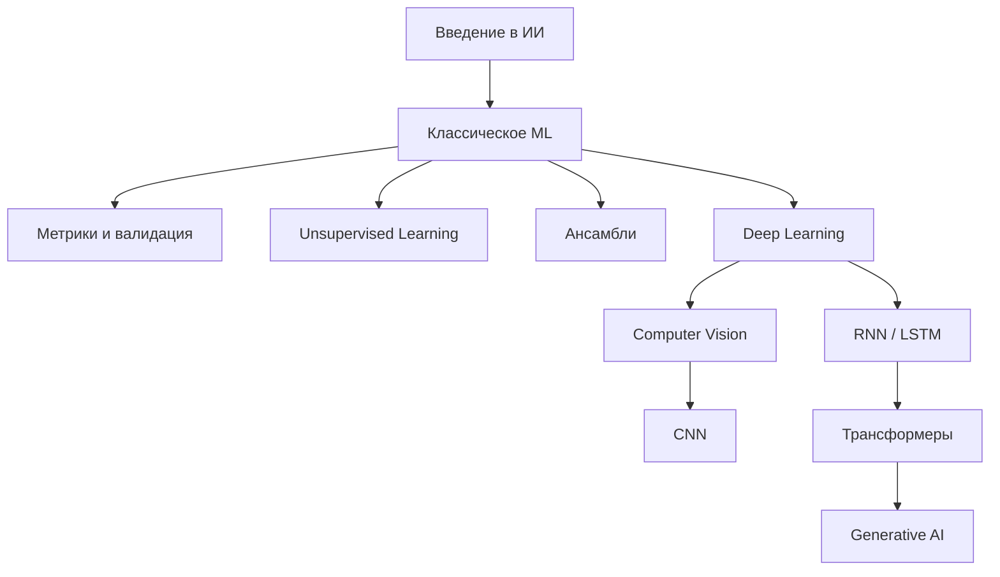

# Дашборд курса СИИ

> [!summary]- Что здесь есть
>
> - Это главный стартовый файл всего конспекта.
> - Здесь собраны быстрые переходы, сворачиваемые шпаргалки, мини-сценарии ответа и маршруты повторения.
> - Индекс вопросов нужен для точечного поиска ответа, а этот дашборд для быстрого и удобного повторения.

## Старт

- [[00 - Индекс вопросов]]
- [[Карта курса.canvas]]
- [[Лекция 01 - Введение в СИИ]]
- [[Лекция 04 - Метрики качества и жизненный цикл ML-модели]]
- [[Лекция 09 - Свёрточные нейросети]]
- [[Лекция 10 - Рекуррентные нейросети]]
- [[Лекция 12 - Генеративный ИИ]]

> [!tip]- Если готовишься за 1 вечер
>
> 1. Пройди `Большие сворачиваемые шпаргалки`.
> 2. Повтори блок `Метрики без путаницы`.
> 3. Повтори блок `CNN, RNN, трансформеры`.
> 4. Пройди `Практические кейсы`.
> 5. В конце открой [[00 - Индекс вопросов]] и точечно проверь слабые темы.

## Карта курса



## Маршруты подготовки

> [!example]- Маршрут 1. Если нужно быстро восстановить базу
>
> - [[Лекция 01 - Введение в СИИ]]
> - [[Лекция 02 - Классическое ML и регрессия]]
> - [[Лекция 03 - Классификация и базовые алгоритмы]]
> - [[Лекция 04 - Метрики качества и жизненный цикл ML-модели]]

> [!example]- Маршрут 2. Если больше всего боишься практики
>
> - [[Лекция 02 - Классическое ML и регрессия#Практический шаблон ответа на задачи 74 и 75]]
> - [[Лекция 03 - Классификация и базовые алгоритмы#Практический шаблон: классификация на экзамене]]
> - [[Лекция 05 - Обучение без учителя#Практический шаблон: решение кейса кластеризации]]
> - [[Лекция 06 - Ансамбли моделей#Практический шаблон: ансамбли на экзамене]]
> - [[Лекция 08 - Компьютерное зрение#Практический шаблон: CV-кейсы на экзамене]]
> - [[Лекция 10 - Рекуррентные нейросети#Практический шаблон: вопрос 90 про NLP-кейс]]
> - [[Лекция 10 - Рекуррентные нейросети#Практический шаблон: вопрос 91 про LSTM]]

> [!example]- Маршрут 3. Если сложнее всего нейросети
>
> - [[Лекция 07 - Глубокое обучение и нейросети]]
> - [[Лекция 09 - Свёрточные нейросети]]
> - [[Лекция 10 - Рекуррентные нейросети]]
> - [[Лекция 11 - Трансформеры]]
> - [[Лекция 12 - Генеративный ИИ]]

## Как строить устный ответ

> [!tip]- Универсальный шаблон ответа почти на любой теоретический вопрос
>
> - Дай определение.
> - Скажи, какую задачу решает метод или раздел.
> - Объясни принцип работы по шагам.
> - Назови ключевые элементы модели или алгоритма.
> - Перечисли преимущества и недостатки.
> - Назови метрики оценки.
> - Приведи 1-2 кейса применения.

> [!question]- Если вопрос звучит размыто
>
> - Если есть слово `понятие`, начинай с определения и места темы в курсе.
> - Если есть `принцип работы`, объясняй алгоритм по шагам.
> - Если есть `сравнение`, проговаривай отличия и сценарии применения.
> - Если есть `оценка качества`, сразу называй метрики и цену ошибки.
> - Если есть `подготовка датасета`, говори про train, validation, test, очистку, утечки и баланс.

> [!warning]- Самые частые ошибки на устном
>
> - Называть алгоритм, но не говорить, какую задачу он решает.
> - Перечислять метрики без объяснения, когда и зачем они нужны.
> - Путать классификацию, детекцию и сегментацию.
> - Путать RNN, LSTM и трансформеры как будто это одно и то же.
> - Говорить `нейросеть обучается`, но не упоминать loss, градиентный спуск и backpropagation.

## Большие сворачиваемые шпаргалки

> [!faq]- Шпаргалка 1. База по ИИ и машинному обучению
> `Что проговорить:`
>
> - ИИ - широкая область, ML - раздел ИИ, DL - раздел ML.
> - Современные системы в основном относятся к слабому и узкому ИИ.
> - Основные типы задач ML: классификация, регрессия, кластеризация, поиск аномалий, генерация.
> - Основные режимы: supervised, unsupervised, reinforcement learning.
>
> `Мини-ответ за 30 секунд:`
>
> - ИИ решает интеллектуальные задачи вычислительными методами.
> - ML позволяет модели учиться на данных.
> - DL строится на многослойных нейросетях.
> - Всё остальное в курсе разворачивается из этих базовых понятий.
>
> `Открыть подробнее:`
>
> - [[Лекция 01 - Введение в СИИ]]
> - [[Лекция 02 - Классическое ML и регрессия#Машинное обучение и его место в системах ИИ]]
> - [[Лекция 02 - Классическое ML и регрессия#Основные разделы машинного обучения]]

> [!faq]- Шпаргалка 2. Подготовка данных и датасетов
> `Что сказать обязательно:`
>
> - Есть объект, признак, таргет, train, validation, test.
> - Данные нужно очистить, привести к единому формату и проверить на утечки.
> - Нужны EDA, проверка пропусков, выбросов, дисбаланса и категориальных признаков.
> - Качество модели очень сильно зависит от качества датасета.
>
> `Короткий чек-лист:`
>
> - Есть ли пропуски?
> - Есть ли выбросы?
> - Нет ли data leakage?
> - Как кодируются категориальные признаки?
> - Репрезентативны ли train и test?
>
> `Открыть подробнее:`
>
> - [[Лекция 02 - Классическое ML и регрессия#Работа с данными: сбор и подготовка]]
> - [[Лекция 02 - Классическое ML и регрессия#Выбросы, аномалии, пропуски и утечка данных]]
> - [[Лекция 02 - Классическое ML и регрессия#Таргет, признаки, корреляция и баланс классов]]
> - [[Лекция 02 - Классическое ML и регрессия#Анализ данных и визуализация]]

> [!faq]- Шпаргалка 3. Классификация и регрессия
> `Регрессия:`
>
> - предсказывает число;
> - примеры: цена, температура, спрос, время;
> - метрики: MAE, MSE, RMSE, MAPE.
>
> `Классификация:`
>
> - предсказывает класс;
> - бывает бинарная, многоклассовая, мультиметочная;
> - метрики: accuracy, precision, recall, F1, ROC-AUC, PR-AUC.
>
> `Открыть подробнее:`
>
> - [[Лекция 02 - Классическое ML и регрессия#Задача регрессии: формулировка и назначение]]
> - [[Лекция 03 - Классификация и базовые алгоритмы#Задача классификации: формулировка]]
> - [[Лекция 04 - Метрики качества и жизненный цикл ML-модели#Метрики для задачи регрессии]]
> - [[Лекция 04 - Метрики качества и жизненный цикл ML-модели#Метрики для задач классификации]]

> [!faq]- Шпаргалка 4. Метрики без путаницы
> `Когда важна общая доля верных ответов:`
>
> - `accuracy`, но только если классы не слишком несбалансированы.
>
> `Когда дорого делать ложные тревоги:`
>
> - `precision`.
>
> `Когда нельзя пропускать положительный класс:`
>
> - `recall`.
>
> `Когда нужен баланс между precision и recall:`
>
> - `F1`.
>
> `Когда сравниваешь модель по разным порогам:`
>
> - `ROC-AUC`.
>
> `Когда положительный класс редкий:`
>
> - особенно важен `PR-AUC`.
>
> `Для регрессии:`
>
> - `MAE` проще интерпретировать;
> - `RMSE` сильнее штрафует большие ошибки.
>
> `Открыть подробнее:`
>
> - [[Лекция 04 - Метрики качества и жизненный цикл ML-модели#Precision, Recall, Specificity, F1]]
> - [[Лекция 04 - Метрики качества и жизненный цикл ML-модели#ROC-AUC и PR-AUC]]
> - [[Лекция 04 - Метрики качества и жизненный цикл ML-модели#Как выбирать метрику]]

> [!faq]- Шпаргалка 5. Линейные, метрические и деревья
> `Линейные модели:`
>
> - строят линейную границу решения;
> - быстрые и интерпретируемые;
> - пример: логистическая регрессия.
>
> `Метрические модели:`
>
> - сравнивают объект с другими по расстоянию;
> - пример: kNN.
>
> `Деревья решений:`
>
> - последовательно задают вопросы по признакам;
> - хорошо объясняются, но легко переобучаются.
>
> `Открыть подробнее:`
>
> - [[Лекция 03 - Классификация и базовые алгоритмы#Линейные и метрические алгоритмы]]
> - [[Лекция 03 - Классификация и базовые алгоритмы#Метод k-ближайших соседей]]
> - [[Лекция 03 - Классификация и базовые алгоритмы#Решающие деревья]]

> [!faq]- Шпаргалка 6. Unsupervised learning
> `Главная идея:`
>
> - таргета нет, модель ищет структуру сама.
>
> `Основные задачи:`
>
> - кластеризация;
> - поиск аномалий;
> - снижение размерности;
> - ассоциативные правила.
>
> `Что помнить по алгоритмам:`
>
> - `k-means` требует число кластеров и любит компактные группы;
> - `DBSCAN` ищет плотные области и умеет выделять шум;
> - `PCA` линейно сжимает данные;
> - `t-SNE` хорош для визуализации, но не для строгой интерпретации расстояний.
>
> `Открыть подробнее:`
>
> - [[Лекция 05 - Обучение без учителя]]

> [!faq]- Шпаргалка 7. Ансамбли за 1 минуту
> `Бэггинг:`
>
> - обучаем много моделей на подвыборках;
> - потом усредняем ответы;
> - пример: Random Forest.
>
> `Бустинг:`
>
> - строим модели последовательно;
> - каждая исправляет ошибки предыдущих;
> - примеры: XGBoost, LightGBM, CatBoost.
>
> `Стэкинг:`
>
> - несколько разных моделей;
> - сверху метамодель, которая учится их комбинировать.
>
> `Открыть подробнее:`
>
> - [[Лекция 06 - Ансамбли моделей#Бэггинг]]
> - [[Лекция 06 - Ансамбли моделей#Бустинг]]
> - [[Лекция 06 - Ансамбли моделей#Стэкинг]]
> - [[Лекция 06 - Ансамбли моделей#Сравнение бэггинга, бустинга и стэкинга]]

> [!faq]- Шпаргалка 8. Нейросети за 1 минуту
> `Нейрон:`
>
> - входы;
> - веса;
> - bias;
> - функция активации.
>
> `Обучение:`
>
> - прямой проход;
> - вычисление loss;
> - backpropagation;
> - gradient descent.
>
> `Проблемы:`
>
> - переобучение;
> - исчезающий градиент;
> - высокая вычислительная стоимость;
> - слабая интерпретируемость.
>
> `Открыть подробнее:`
>
> - [[Лекция 07 - Глубокое обучение и нейросети#Что такое искусственный нейрон]]
> - [[Лекция 07 - Глубокое обучение и нейросети#Градиентный спуск]]
> - [[Лекция 07 - Глубокое обучение и нейросети#Обратное распространение ошибки]]
> - [[Лекция 07 - Глубокое обучение и нейросети#Функции активации]]

> [!faq]- Шпаргалка 9. CV без путаницы
> `Классификация:`
>
> - отвечает на вопрос `что изображено`.
>
> `Детекция:`
>
> - отвечает на вопросы `что изображено` и `где`.
>
> `Сегментация:`
>
> - определяет, какие пиксели принадлежат объекту.
>
> `Метрики:`
>
> - классификация: accuracy, F1;
> - детекция: IoU, mAP;
> - сегментация: IoU, Dice.
>
> `Открыть подробнее:`
>
> - [[Лекция 08 - Компьютерное зрение#Отличия классификации, детекции и сегментации]]
> - [[Лекция 08 - Компьютерное зрение#Метрики качества в компьютерном зрении]]

> [!faq]- Шпаргалка 10. CNN, RNN, трансформеры
> `CNN:`
>
> - работают с изображениями;
> - используют свёртки, карты признаков, pooling;
> - примеры: VGG, ResNet, YOLO.
>
> `RNN / LSTM:`
>
> - работают с последовательностями;
> - учитывают контекст;
> - LSTM лучше хранит долгосрочную информацию.
>
> `Трансформеры:`
>
> - используют attention вместо рекуррентности;
> - лучше масштабируются;
> - стали базой современных LLM.
>
> `Открыть подробнее:`
>
> - [[Лекция 09 - Свёрточные нейросети]]
> - [[Лекция 10 - Рекуррентные нейросети]]
> - [[Лекция 11 - Трансформеры]]

> [!faq]- Шпаргалка 11. GenAI за 1 минуту
> `GAN:`
>
> - генератор и дискриминатор;
> - состязательное обучение.
>
> `VAE:`
>
> - энкодер, латентное пространство, декодер;
> - генерация через скрытое вероятностное пространство.
>
> `Diffusion:`
>
> - генерация через поэтапное удаление шума.
>
> `Трансформерные GenAI-модели:`
>
> - текст, код, мультимодальность.
>
> `Открыть подробнее:`
>
> - [[Лекция 12 - Генеративный ИИ#Виды генеративных моделей]]
> - [[Лекция 12 - Генеративный ИИ#Генеративно-состязательные сети]]
> - [[Лекция 12 - Генеративный ИИ#Вариационные автоэнкодеры]]
> - [[Лекция 12 - Генеративный ИИ#Диффузионные модели]]

## Практические кейсы

> [!success]- Универсальный шаблон ответа на практический вопрос
>
> - Назвать задачу.
> - Назвать таргет и признаки.
> - Описать подготовку датасета.
> - Рассказать, как делятся выборки.
> - Назвать модель и ключевые гиперпараметры.
> - Назвать метрики.
> - Сказать, как бы улучшал качество.

> [!faq]- Практика. Регрессия и классификация
>
> - [[Лекция 02 - Классическое ML и регрессия#Практический шаблон ответа на задачи 74 и 75]]
> - [[Лекция 03 - Классификация и базовые алгоритмы#Практический шаблон: классификация на экзамене]]

> [!faq]- Практика. Кластеризация и ансамбли
>
> - [[Лекция 05 - Обучение без учителя#Практический шаблон: решение кейса кластеризации]]
> - [[Лекция 06 - Ансамбли моделей#Практический шаблон: ансамбли на экзамене]]

> [!faq]- Практика. CV и NLP
>
> - [[Лекция 08 - Компьютерное зрение#Практический шаблон: CV-кейсы на экзамене]]
> - [[Лекция 10 - Рекуррентные нейросети#Практический шаблон: вопрос 90 про NLP-кейс]]
> - [[Лекция 10 - Рекуррентные нейросети#Практический шаблон: вопрос 91 про LSTM]]

## Интерактивные врезки и встроенные фрагменты

> [!question]- Если путаются алгоритмы
> Открой:
>
> - [[Лекция 03 - Классификация и базовые алгоритмы#Линейные и метрические алгоритмы]]
> - [[Лекция 05 - Обучение без учителя#Методы кластеризации]]
> - [[Лекция 06 - Ансамбли моделей#Сравнение бэггинга, бустинга и стэкинга]]
> - [[Лекция 09 - Свёрточные нейросети#Архитектура CNN и отличие от полносвязной сети]]
> - [[Лекция 10 - Рекуррентные нейросети#LSTM]]
> - [[Лекция 11 - Трансформеры#Механизм внимания]]

> [!abstract]- Встроенные ключевые фрагменты
> ![[Лекция 04 - Метрики качества и жизненный цикл ML-модели#Как выбирать метрику]]
> ![[Лекция 09 - Свёрточные нейросети#Дообучение нейросетей: transfer learning, feature extraction, fine tuning]]
> ![[Лекция 10 - Рекуррентные нейросети#Практический шаблон: вопрос 91 про LSTM]]

## Сравнительные мини-таблицы

> [!info]- Быстрое сравнение алгоритмов классификации
> | Алгоритм | Сильная сторона | Слабая сторона |
> | --- | --- | --- |
> | LogReg | простота и интерпретация | линейность |
> | Naive Bayes | скорость и простота | независимость признаков редко выполняется |
> | SVM | сильный на сложных границах | тяжёлый на больших данных |
> | kNN | интуитивность | медленный и чувствителен к масштабу |
> | Decision Tree | объяснимость | легко переобучается |

> [!info]- Быстрое сравнение ансамблей
> | Подход | Идея | Типичный пример |
> | --- | --- | --- |
> | Бэггинг | усреднить много моделей | Random Forest |
> | Бустинг | исправлять ошибки последовательно | XGBoost, CatBoost |
> | Стэкинг | объединить разные модели метамоделью | stacking ensemble |

> [!info]- Быстрое сравнение нейросетей
> | Архитектура | Для чего | Ключевая идея |
> | --- | --- | --- |
> | CNN | изображения | свёртки и локальные признаки |
> | RNN | последовательности | память о прошлом |
> | LSTM | длинные зависимости | управляемая память через вентили |
> | Transformer | длинный контекст | self-attention |

## Чек-лист подготовки

- [ ] Повторить определения ИИ, ML, DL
- [ ] Освежить supervised / unsupervised
- [ ] Повторить метрики классификации и регрессии
- [ ] Отдельно проговорить ROC-AUC и PR-AUC
- [ ] Повторить k-means, DBSCAN, PCA
- [ ] Повторить бэггинг, бустинг, стэкинг
- [ ] Повторить нейрон, backprop, активации
- [ ] Повторить CV: классификация, детекция, сегментация
- [ ] Повторить CNN, ResNet, YOLO
- [ ] Повторить RNN, LSTM, attention
- [ ] Повторить трансформеры
- [ ] Повторить GAN, VAE, diffusion

## Чек-лист прямо перед устным ответом

- [ ] Я назвал определение без лишней воды
- [ ] Я сказал, какую задачу решает метод
- [ ] Я объяснил принцип работы по шагам
- [ ] Я перечислил плюсы и минусы
- [ ] Я назвал метрики
- [ ] Я привёл хотя бы один кейс применения

## Поиск по тегам

```query
tag:#sii/lecture
```

```query
tag:#metrics OR tag:#mlops
```

```query
tag:#cv OR tag:#cnn
```

```query
tag:#nlp OR tag:#transformers OR tag:#genai
```

## Сворачиваемые подборки

> [!faq]- Блок 1. База по ML
>
> - [[Лекция 01 - Введение в СИИ]]
> - [[Лекция 02 - Классическое ML и регрессия]]
> - [[Лекция 03 - Классификация и базовые алгоритмы]]
> - [[Лекция 04 - Метрики качества и жизненный цикл ML-модели]]

> [!faq]- Блок 2. Unsupervised и ансамбли
>
> - [[Лекция 05 - Обучение без учителя]]
> - [[Лекция 06 - Ансамбли моделей]]

> [!faq]- Блок 3. Deep Learning и CV
>
> - [[Лекция 07 - Глубокое обучение и нейросети]]
> - [[Лекция 08 - Компьютерное зрение]]
> - [[Лекция 09 - Свёрточные нейросети]]

> [!faq]- Блок 4. Последовательности и генерация
>
> - [[Лекция 10 - Рекуррентные нейросети]]
> - [[Лекция 11 - Трансформеры]]
> - [[Лекция 12 - Генеративный ИИ]]

## Маршруты по слабым темам

> [!bug]- Если плаваешь в метриках
>
> - [[Лекция 04 - Метрики качества и жизненный цикл ML-модели#Метрики для задачи регрессии]]
> - [[Лекция 04 - Метрики качества и жизненный цикл ML-модели#Precision, Recall, Specificity, F1]]
> - [[Лекция 04 - Метрики качества и жизненный цикл ML-модели#ROC-AUC и PR-AUC]]

> [!bug]- Если плаваешь в компьютерном зрении
>
> - [[Лекция 08 - Компьютерное зрение#Основные задачи компьютерного зрения]]
> - [[Лекция 08 - Компьютерное зрение#Отличия классификации, детекции и сегментации]]
> - [[Лекция 09 - Свёрточные нейросети#Архитектура CNN и отличие от полносвязной сети]]
> - [[Лекция 09 - Свёрточные нейросети#Семейство YOLO]]

> [!bug]- Если плаваешь в NLP и GenAI
>
> - [[Лекция 10 - Рекуррентные нейросети#Эмбеддинги]]
> - [[Лекция 10 - Рекуррентные нейросети#LSTM]]
> - [[Лекция 11 - Трансформеры#Механизм внимания]]
> - [[Лекция 12 - Генеративный ИИ#Виды генеративных моделей]]
