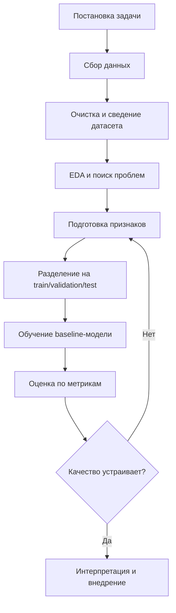

# Лекция 02. Классическое ML и регрессия

Источник: [[lec2.pdf]]

## Что покрывает эта лекция

- Вопросы экзамена: 5, 6, 8, 9, 12, 24, 33, 34, 35, 36, 37, 38, 74, 75.
- Частично: вопрос 10 о линейных и метрических алгоритмах, так как здесь закладывается базовая терминология.

## Блок-схема подготовки табличных данных

## Машинное обучение и его место в системах ИИ

Машинное обучение (`Machine Learning`) - это раздел искусственного интеллекта, в котором модели строятся не только вручную по правилам, а обучаются на данных, извлекая закономерности из примеров.

Почему ML считается частью ИИ:

- оно позволяет автоматизировать принятие решений;
- даёт системе способность улучшать качество по мере накопления опыта;
- применяется для распознавания, прогнозирования, ранжирования, генерации признаков и других интеллектуальных задач.

Связь понятий удобно описывать так:

- `ИИ` - широкая область;
- `ML` - обучение по данным;
- `DL` - нейросетевой подвид ML;
- `классическое ML` - алгоритмы, которые обычно работают на табличных, структурированных, сравнительно компактных данных и требуют более явной работы с признаками.

## Основные разделы машинного обучения

### Обучение с учителем

Есть пары вида `объект -> правильный ответ`. Модель учится предсказывать целевую переменную по размеченным примерам.

Типовые задачи:

- классификация;
- регрессия;
- ранжирование;
- прогнозирование вероятности события.

### Обучение без учителя

Разметки нет, модель ищет структуру данных сама.

Типовые задачи:

- кластеризация;
- поиск аномалий;
- снижение размерности;
- ассоциативные правила.

### Обучение с подкреплением

Агент взаимодействует со средой, получает награду и постепенно учится максимизировать долгосрочную выгоду. В курсе это подробнее появляется позже, но для общей картины помнить полезно.

## Что обычно называют классическим машинным обучением

Под классическим ML чаще всего понимают семейство алгоритмов, не основанных на глубоких многослойных нейросетях:

- линейная и логистическая регрессия;
- наивный Байес;
- SVM;
- kNN;
- деревья решений;
- случайный лес;
- градиентный бустинг;
- методы кластеризации;
- методы снижения размерности.

Отличительная черта классического ML: качество часто сильно зависит от инженерии признаков, очистки данных, нормализации и правильной постановки задачи.

## Основные задачи классического машинного обучения и их постановка

### Регрессия

Цель: предсказать численное значение.

Примеры:

- стоимость квартиры;
- спрос на товар;
- температура;
- выручка;
- время доставки.

### Классификация

Цель: отнести объект к одному из конечного набора классов.

Примеры:

- спам или не спам;
- болен или здоров;
- уйдёт клиент или останется.

### Кластеризация

Цель: разбить объекты на группы без заранее известных меток.

Примеры:

- сегментация клиентов;
- группировка документов;
- поиск похожих пользователей.

### Дополнительные задачи

- снижение размерности;
- поиск аномалий;
- рекомендации;
- извлечение ассоциаций и шаблонов поведения.

## Обучение с учителем: формулировка и терминология

### Основные сущности

- `Объект` - отдельное наблюдение, запись, sample.
- `Признак` - характеристика объекта, feature.
- `Таргет` - целевая переменная, target.
- `Датасет` - набор объектов и связанных с ними признаков, а при обучении с учителем ещё и ответов.
- `Модель` - функция, которая по признакам предсказывает ответ.

### Типы признаков

- числовые;
- категориальные;
- бинарные;
- порядковые;
- текстовые;
- временные;
- графовые;
- мультимодальные.

### Разметка

Разметка - это процесс присвоения правильных ответов объектам. Она может быть:

- ручной;
- полуавтоматической;
- автоматической;
- синтетической.

Качество разметки критично: плохая разметка делает плохой даже самый сильный алгоритм.

## Данные, датасеты и выборки

### Не путать данные и датасет

- `Данные` - любые сырые наблюдения.
- `Датасет` - подготовленная структура, пригодная для анализа или обучения.

### Основные выборки

- `Train` - обучающая выборка.
- `Validation` - валидационная выборка для подбора гиперпараметров и ранней остановки.
- `Test` - финальная проверка качества.

Правило, которое почти всегда спрашивают: `test` не участвует в обучении и подборе модели.

### Репрезентативность

Выборка должна отражать реальный мир, в котором будет работать модель:

- по распределению признаков;
- по долям классов;
- по временным периодам;
- по сценариям использования.

Если обучающая и боевая среда сильно различаются, модель быстро деградирует.

## Работа с данными: сбор и подготовка

### Как собирают данные

- выгрузки из корпоративных систем;
- логи приложений;
- опросы и формы;
- сенсоры и камеры;
- парсинг открытых источников;
- разметка человеком;
- синтетическая генерация.

### Этапы подготовки датасета

1. Понять бизнес-задачу и целевую переменную.
2. Собрать источники данных.
3. Свести данные в единую схему.
4. Очистить ошибки, дубли, пропуски и противоречия.
5. Подготовить признаки.
6. Разделить данные на выборки.
7. Проверить, нет ли утечки данных.
8. Оценить баланс таргета и качество признаков.

### Основные проблемы в датасетах

- пропуски;
- выбросы;
- шум;
- ошибки разметки;
- дубли;
- несогласованные форматы;
- сдвиг распределений;
- дисбаланс классов;
- утечка данных;
- слишком малый объём;
- неактуальные данные.

## Выбросы, аномалии, пропуски и утечка данных

### Пропуски

Возникают, когда значение признака отсутствует.

Что можно делать:

- удалить объект;
- удалить признак;
- заполнить средним, медианой, модой;
- использовать модельную импутацию;
- добавить бинарный признак факта пропуска.

### Выбросы и аномалии

- `Выброс` - экстремальное значение, нехарактерное для основной массы наблюдений.
- `Аномалия` - объект, существенно отличающийся от типичного поведения.

Не каждый выброс нужно удалять: иногда он отражает важное реальное событие.

### Утечка данных

Это одна из самых опасных ошибок.

Утечка возникает, когда в признаки попадает информация, недоступная в реальном моменте предсказания, либо признак слишком прямо кодирует ответ.

Примеры:

- дата закрытия кредита используется для предсказания дефолта до закрытия;
- признак почти повторяет таргет;
- нормализация выполнена по всему датасету до разделения на train/test.

### Категориальные признаки

Их нельзя просто подавать в модель как текст.

Основные способы кодирования:

- `One-Hot Encoding`;
- ordinal encoding;
- target encoding;
- frequency encoding;
- встроенная обработка в CatBoost.

## Таргет, признаки, корреляция и баланс классов

### Таргет

Таргет - это то, что мы хотим предсказывать. Его постановка должна быть:

- однозначной;
- измеримой;
- доступной в данных;
- полезной для бизнеса или предметной области.

### Отбор признаков

Отбор признаков нужен, чтобы:

- убрать шум;
- уменьшить переобучение;
- ускорить обучение;
- повысить интерпретируемость.

Подходы:

- экспертный отбор;
- статистический анализ;
- отбор по важности в модели;
- фильтрующие методы;
- wrapper-методы;
- embedded-методы.

### Матрица корреляции

Матрица корреляции показывает степень линейной связи между числовыми признаками. Она полезна для:

- поиска избыточных признаков;
- обнаружения мультиколлинеарности;
- предварительного понимания структуры данных.

Но корреляция не равна причинности. Кроме того, слабая линейная корреляция не означает отсутствие нелинейной зависимости.

### Баланс классов

Если один класс встречается намного чаще другого, возникает дисбаланс.

Это важно потому, что модель может показывать высокую accuracy и при этом плохо находить редкий, но важный класс.

Способы работы:

- oversampling;
- undersampling;
- взвешивание классов;
- выбор другой метрики;
- генерация синтетических примеров, например `SMOTE`.

## Анализ данных и визуализация

Перед обучением модели почти всегда делают `EDA` - exploratory data analysis.

### Цели EDA

- понять распределения признаков;
- найти выбросы и пропуски;
- оценить зависимости;
- заметить проблемы разметки;
- определить, какие преобразования нужны.

### Типовые инструменты визуализации

- гистограммы;
- boxplot, или ящик с усами;
- scatter plot;
- violin plot;
- тепловая карта корреляций;
- bar chart для категориальных признаков;
- временные графики.

### Как читать boxplot

- середина коробки - медиана;
- нижняя и верхняя границы - квартильные значения;
- длина коробки отражает межквартильный размах;
- точки далеко за пределами усов часто рассматриваются как кандидаты в выбросы.

## Кросс-валидация, параметры и гиперпараметры

### Параметры модели

Это то, что модель учит сама:

- веса линейной регрессии;
- коэффициенты логистической регрессии;
- значения в деревьях;
- веса нейросети.

### Гиперпараметры

Это то, что задаёт разработчик до обучения:

- глубина дерева;
- количество соседей в `kNN`;
- коэффициент регуляризации;
- число деревьев в ансамбле.

### Кросс-валидация

Кросс-валидация нужна, чтобы надёжнее оценить качество модели на ограниченном датасете.

Самый известный вариант - `k-fold cross-validation`:

1. Данные делят на `k` фолдов.
2. Модель `k` раз обучают на `k-1` частях.
3. Оставшийся фолд каждый раз используют для проверки.
4. Затем метрики усредняют.

Плюсы:

- меньше зависимость от случайного разбиения;
- более стабильная оценка качества;
- удобна для подбора гиперпараметров.

## Жизненный цикл модели машинного обучения

Этот вопрос редко хорошо раскрывается на слайдах, поэтому здесь лучше запомнить полный конвейер.

### Этапы жизненного цикла

1. Формулировка задачи и бизнес-критерия успеха.
2. Сбор и аудит данных.
3. Разметка и подготовка датасета.
4. EDA и построение признаков.
5. Выбор baseline-модели.
6. Обучение и подбор гиперпараметров.
7. Оценка на валидации и тесте.
8. Интерпретация и проверка рисков.
9. Развёртывание.
10. Мониторинг качества, дрейфа данных и переобучения.
11. Переобучение и обновление модели.

### Пример реального кейса

Кейс: прогноз оттока клиентов мобильного оператора.

1. Бизнес хочет снизить отток.
2. Формулируется таргет: ушёл ли клиент в течение следующих `N` дней.
3. Собираются данные: тариф, частота звонков, пополнения, обращения, интернет-трафик.
4. Проверяются пропуски, дисбаланс, утечки.
5. Строятся признаки: средний чек, динамика трафика, число жалоб.
6. Обучается baseline, например логистическая регрессия.
7. Затем сравниваются более сильные модели.
8. Выбирается порог с учётом стоимости ошибки.
9. Модель встраивается в CRM-процесс удержания.
10. После запуска контролируются дрейф данных и фактический бизнес-эффект.

## Задача регрессии: формулировка и назначение

Регрессия - это задача предсказания численного значения или числовой функции зависимости одной переменной от других.

### Когда регрессия нужна

- прогноз цены;
- оценка спроса;
- оценка времени;
- прогноз температуры;
- прогноз нагрузки;
- оценка вероятности в непрерывной шкале риска.

### Что именно ищет модель

Модель пытается аппроксимировать неизвестную зависимость:

`y = f(x) + ε`

где:

- `x` - вектор признаков;
- `y` - целевая переменная;
- `ε` - шум.

## Виды регрессии

### Линейная регрессия

Предполагает линейную зависимость между признаками и таргетом.

### Множественная линейная регрессия

Линейная регрессия с несколькими признаками.

### Полиномиальная регрессия

Позволяет моделировать нелинейность через расширение пространства признаков.

### Логистическая регрессия

Название содержит слово `регрессия`, но на практике чаще используется как классификатор, предсказывающий вероятность класса.

### Другие варианты

- ridge;
- lasso;
- elastic net;
- quantile regression;
- robust regression.

## Метод наименьших квадратов

Для линейной регрессии классический способ оценки коэффициентов - `метод наименьших квадратов` (`OLS`).

Идея:

- для каждого объекта модель даёт предсказание;
- считаем ошибку как разность между истинным и предсказанным значением;
- выбираем коэффициенты так, чтобы сумма квадратов ошибок была минимальной.

Почему именно квадрат:

- квадрат делает знак ошибки неважным;
- сильнее штрафует большие промахи;
- даёт удобную математику и аналитические свойства.

## Функции потерь и ошибки в регрессии

### MSE

`Mean Squared Error` - средний квадрат ошибки.

Плюсы:

- удобна математически;
- сильно штрафует большие ошибки.

Минусы:

- чувствительна к выбросам.

### MAE

`Mean Absolute Error` - средняя абсолютная ошибка.

Плюсы:

- устойчивее к выбросам;
- хорошо интерпретируется в единицах исходной величины.

Минусы:

- менее гладкая для оптимизации.

### RMSE

Корень из MSE. Полезен тем, что возвращает ошибку в исходных единицах измерения.

### MAPE

Средняя абсолютная процентная ошибка.

Полезна, когда нужна относительная интерпретация ошибки, но плохо ведёт себя около нулевых значений таргета.

## Преимущества и недостатки регрессии

### Преимущества

- понятная постановка;
- хорошая интерпретируемость;
- сильный baseline для многих задач;
- хорошо подходит для анализа факторов;
- масштабируется на большие наборы табличных данных.

### Недостатки

- чувствительность к выбросам;
- риск неверных предположений о линейности;
- зависимость качества от признаков;
- необходимость аккуратной подготовки данных;
- переобучение при избыточной сложности.

## Практический шаблон ответа на задачи 74 и 75

### Как решать кейс линейной регрессии на экзамене

1. Сформулировать таргет и признаки.
2. Провести EDA: пропуски, выбросы, корреляции, масштабы.
3. Разделить данные на train/validation/test.
4. Подготовить признаки: кодирование категориальных, масштабирование при необходимости.
5. Обучить baseline, например линейную регрессию.
6. Оценить качество по `MAE`, `MSE`, `RMSE`, при необходимости `MAPE`.
7. Проверить остатки и стабильность модели.
8. Интерпретировать коэффициенты и ограничения.

### Что проговорить в ответе

- почему выбрана именно регрессия;
- какие признаки важны;
- есть ли выбросы и как с ними работали;
- какая метрика основная и почему;
- в чём ограничения модели и как можно улучшить решение.

## Краткие выводы

- Классическое ML особенно эффективно на структурированных данных.
- Качество модели часто определяется качеством данных и признаков.
- Регрессия предсказывает численное значение и решается через поиск зависимости между признаками и таргетом.
- Подготовка датасета, кросс-валидация и контроль утечек не менее важны, чем выбор алгоритма.
