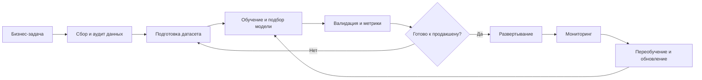

# Лекция 04. Метрики качества и жизненный цикл ML-модели

Источник: [[lec4.pdf]]

## Что покрывает эта лекция

- Вопросы экзамена: 19, 20, 21, 22, 23, 24, 33.
- Частично поддерживает многие практические вопросы, потому что без метрик и схемы валидации нельзя корректно защитить ни один кейс.

## Блок-схема жизненного цикла ML-модели

## Зачем вообще оценивать качество модели

Модель может отлично выглядеть на обучающей выборке и плохо работать в реальности. Поэтому оценка качества нужна, чтобы понять:

- насколько решение полезно;
- насколько оно стабильно;
- можно ли его внедрять;
- не переобучилась ли модель;
- какие ошибки наиболее опасны.

Ключевое правило: качество модели не оценивают только по train.

## Основные определения

### Качество

Качество ИИ-системы - это совокупность свойств, определяющих, насколько хорошо она выполняет поставленную задачу в соответствии с требованиями.

### Метрика

Метрика - количественная функция оценки результата работы модели.

Важно: `метрика` и `функция потерь` не одно и то же.

- `Функция потерь` обычно используется при обучении и оптимизации.
- `Метрика` используется для оценки результата на выборке.

Иногда они совпадают по смыслу, но не обязаны совпадать буквально.

## Уровни оценки качества

Полезно помнить иерархию:

- `Бизнес-метрики`: прибыль, снижение издержек, удержание клиентов.
- `Пользовательские метрики`: удобство, время ответа, качество опыта.
- `Технические метрики`: accuracy, MAE, ROC-AUC, latency и другие.
- `Функция потерь`: внутренняя оптимизационная цель модели.

На экзамене сильный ответ обычно связывает техническую метрику с реальной ценой ошибки.

## Емкость модели, интерпретируемость и робастность

### Емкость модели

Емкость - это способность модели аппроксимировать широкий класс зависимостей.

- высокая емкость даёт гибкость;
- слишком высокая емкость увеличивает риск переобучения;
- слишком низкая приводит к недообучению.

### Интерпретируемость

Интерпретируемость показывает, насколько человек может объяснить:

- почему модель приняла решение;
- какие признаки были важны;
- как изменение признака влияет на ответ.

Примеры интерпретируемых моделей:

- линейная регрессия;
- логистическая регрессия;
- небольшие деревья решений.

### Робастность

Робастность - устойчивость модели к шуму, выбросам, небольшим искажениям входных данных и смене условий эксплуатации.

Модель может быть точной на чистых данных и неробастной в реальном мире.

## Ошибка обучения и ошибка тестирования

- `Ошибка обучения` - метрика на train.
- `Ошибка тестирования` - метрика на test.

Если train-ошибка очень мала, а test-ошибка заметно выше, это признак переобучения.

## Метрики для задачи регрессии

### MAE

`Mean Absolute Error`:

- показывает среднюю абсолютную ошибку;
- легко интерпретируется;
- устойчивее к выбросам, чем MSE.

### MSE

`Mean Squared Error`:

- сильно штрафует большие ошибки;
- удобна для оптимизации;
- чувствительна к выбросам.

### RMSE

Корень из MSE:

- возвращает ошибку в исходных единицах;
- сильнее выделяет крупные промахи.

### MAPE

Средняя абсолютная процентная ошибка:

- удобна для относительной интерпретации;
- плохо работает при значениях таргета около нуля.

### R²

Хотя на слайдах эта метрика почти не раскрыта, для полного ответа полезно знать:

- `R²` показывает долю объяснённой вариации;
- `1` - идеально;
- `0` - модель не лучше среднего;
- отрицательное значение означает очень плохое качество.

## Метрики для задач классификации

### Accuracy

`Accuracy = (TP + TN) / (TP + TN + FP + FN)`

Показывает долю верных ответов.

Плюсы:

- проста;
- понятна.

Минусы:

- не учитывает дисбаланс классов;
- не отражает цену разных типов ошибки.

### Error rate

Доля ошибок:

`Error rate = 1 - Accuracy`

Полезна как дополнительная характеристика, но не решает проблемы accuracy.

## Confusion matrix

Матрица ошибок - фундамент для понимания классификатора.

### Элементы

- `TP` - истинно положительные.
- `TN` - истинно отрицательные.
- `FP` - ложноположительные.
- `FN` - ложноотрицательные.

### Почему это важно

Одинаковая accuracy может скрывать принципиально разный профиль ошибки.

Например:

- в медицине часто критичнее `FN`, потому что больного нельзя пропустить;
- в антиспаме критичнее `FP`, потому что нельзя терять нормальные письма.

## Precision, Recall, Specificity, F1

### Precision

`Precision = TP / (TP + FP)`

Из всех объектов, которые модель назвала положительными, сколько оказались действительно положительными.

Важна, когда дорог `FP`.

### Recall

`Recall = TP / (TP + FN)`

Из всех реально положительных объектов сколько модель нашла.

Важна, когда дорог `FN`.

### Specificity

`Specificity = TN / (TN + FP)`

Показывает, насколько хорошо модель распознаёт отрицательный класс.

### F1-мера

Гармоническое среднее precision и recall:

`F1 = 2 * Precision * Recall / (Precision + Recall)`

Полезна, когда нужен баланс между полнотой и точностью.

### F-бета

Если одна из метрик важнее, используют `Fβ`:

- `β > 1` - больший акцент на recall;
- `β < 1` - больший акцент на precision.

## ROC-AUC и PR-AUC

### ROC-кривая

ROC-кривая строится по:

- `TPR`, то есть recall;
- `FPR`, доле ложноположительных.

Она показывает, как меняется качество классификатора при изменении порога.

### ROC-AUC

Площадь под ROC-кривой:

- `1` - идеально;
- `0.5` - примерно случайный классификатор.

Плюсы:

- удобна для сравнения моделей;
- учитывает поведение на разных порогах.

Минусы:

- может быть слишком оптимистичной при сильном дисбалансе классов.

### PR-кривая

Строится по:

- `Precision`;
- `Recall`.

Особенно полезна, когда положительный класс редкий.

### PR-AUC и Average Precision

Площадь под PR-кривой отражает среднее качество ранжирования положительного класса. Часто говорят `Average Precision`.

Практическая интерпретация:

- чем выше `PR-AUC`, тем лучше модель находит редкий важный класс без чрезмерного роста ложных срабатываний.

## Оценка многоклассовой классификации

Для многокласса обычно применяют подход `one-vs-rest`: каждый класс по очереди рассматривают как положительный, а остальные как отрицательные.

### Усреднение метрик

#### Macro

- метрика считается для каждого класса отдельно;
- затем значения усредняются;
- все классы равноправны.

#### Micro

- сначала суммируют все TP, FP, FN по классам;
- потом считают одну общую метрику;
- сильнее отражает вклад частых классов.

#### Weighted

- усреднение с весами пропорционально размеру класса;
- компромисс между macro и micro.

### Когда что выбирать

- `macro` - когда важны редкие классы;
- `micro` - когда нужен общий потоковый результат;
- `weighted` - когда хочется учитывать частоту классов, но не терять многоклассовую интерпретацию.

## Коэффициент корреляции Мэтьюса

`MCC` - сбалансированная метрика для бинарной классификации, учитывающая все элементы матрицы ошибок.

Диапазон:

- `1` - идеальная классификация;
- `0` - случайное качество;
- `-1` - полное противоречие истине.

Полезен при дисбалансе классов и часто информативнее, чем accuracy.

## Как выбирать метрику

Хороший ответ на экзамене должен звучать не как перечисление формул, а как обоснование выбора.

### Если задача регрессии

- `MAE` - когда нужна понятная средняя ошибка и устойчивость к выбросам;
- `RMSE` - когда большие ошибки особенно опасны;
- `MAPE` - когда важна ошибка в процентах;
- `R²` - когда нужно показать долю объяснённой вариации.

### Если задача классификации

- `Accuracy` - только при хорошей сбалансированности классов;
- `Precision` - когда критичны ложные тревоги;
- `Recall` - когда нельзя пропускать положительный класс;
- `F1` - когда нужен баланс;
- `ROC-AUC` - для оценки ранжирования по порогам;
- `PR-AUC` - особенно при редком положительном классе.

## Кросс-валидация и настройка модели

### Принцип кросс-валидации

Кросс-валидация нужна для более устойчивой оценки качества и подбора гиперпараметров.

Самый распространённый способ - `k-fold`:

1. Датасет делят на `k` частей.
2. На каждой итерации одну часть оставляют для валидации, остальные используют для обучения.
3. Метрики усредняют.

### Параметры и гиперпараметры

- `Параметры` модель учит сама.
- `Гиперпараметры` выбирает инженер.

Примеры гиперпараметров:

- глубина дерева;
- `C` в логистической регрессии и SVM;
- число соседей в `kNN`;
- learning rate;
- число деревьев в ансамбле.

### Оптимизация гиперпараметров

Основные подходы:

- `Grid Search`;
- `Random Search`;
- байесовская оптимизация;
- эволюционные и гибридные методы.

## Жизненный цикл модели машинного обучения

### Полная схема

1. Формулировка задачи.
2. Определение бизнес-метрики успеха.
3. Сбор и проверка данных.
4. Подготовка датасета.
5. Построение признаков.
6. Выбор baseline.
7. Обучение и валидация.
8. Подбор гиперпараметров.
9. Финальная оценка на test.
10. Развёртывание.
11. Мониторинг качества и дрейфа.
12. Переобучение и обновление.

### Разбор на реальном кейсе

Кейс: модель оценки вероятности мошенничества по транзакциям.

1. Цель: остановить подозрительные операции.
2. Важная бизнес-метрика: снижение убытков без чрезмерной блокировки честных клиентов.
3. Данные: сумма, время, устройство, география, история клиента.
4. Из-за дисбаланса классов accuracy почти бесполезна.
5. Строят baseline, например логистическую регрессию.
6. Далее сравнивают ансамбли и бустинги.
7. Метрики: `ROC-AUC`, `PR-AUC`, `Recall`, стоимость ошибок.
8. После внедрения настраивают пороги и мониторят дрейф паттернов мошенничества.

## Что часто спрашивают вместе с метриками

### Почему нельзя смотреть только на accuracy

Потому что при дисбалансе классов модель может просто угадывать частый класс и выглядеть хорошей.

### Почему нельзя оценивать по train

Потому что модель может запомнить обучающую выборку, а не научиться обобщать.

### Что лучше: ROC-AUC или PR-AUC

- `ROC-AUC` хорошо показывает ранжирование в целом;
- `PR-AUC` обычно полезнее при редком положительном классе.

## Краткие выводы

- Метрики нужны, чтобы оценивать не только факт ошибки, но и её характер.
- Для регрессии важны `MAE`, `MSE`, `RMSE`, `MAPE`, `R²`.
- Для классификации критичны `confusion matrix`, `precision`, `recall`, `F1`, `specificity`, `ROC-AUC`, `PR-AUC`.
- Жизненный цикл модели не заканчивается обучением: после внедрения начинается мониторинг и поддержка.
