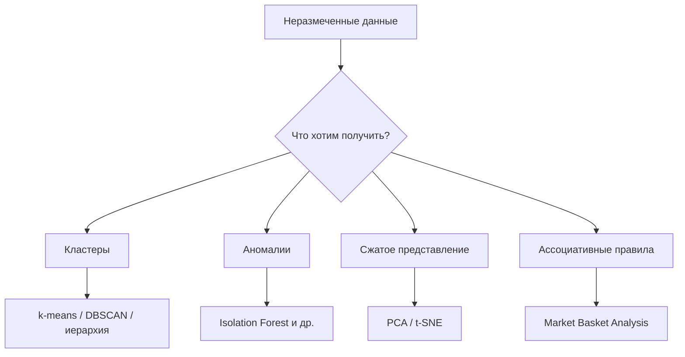

# Лекция 05. Обучение без учителя

Источник: [[lec5.pdf]]

## Что покрывает эта лекция

- Вопросы экзамена: 11, 25, 26, 27, 80.
- Частично помогает для вопросов по анализу данных и поиску скрытых структур в выборке.

## Блок-схема unsupervised-задач

## Что такое обучение без учителя

`Unsupervised learning` - это постановка, в которой у объектов нет готовой целевой метки, а модель должна сама обнаружить структуру данных.

Главная идея:

- в `supervised learning` мы знаем правильный ответ;
- в `unsupervised learning` мы ищем закономерности без заранее заданного ответа.

## Когда обучение без учителя особенно полезно

- когда разметка слишком дорогая или невозможна;
- когда нужно исследовать данные до постановки supervised-задачи;
- когда важно найти скрытые группы, аномалии или компактные представления данных;
- когда нужно получить новые признаки из сырого набора.

## Основные задачи обучения без учителя

### Кластеризация

Разбиение объектов на группы так, чтобы объекты внутри кластера были более похожи друг на друга, чем на объекты из других кластеров.

### Поиск ассоциативных правил

Выявление часто совместно встречающихся элементов и шаблонов вида `если X, то часто Y`.

### Снижение размерности

Сжатие пространства признаков с сохранением как можно большего количества полезной информации.

### Обнаружение аномалий

Поиск объектов, которые сильно отличаются от основной массы наблюдений.

## Особенности постановки задачи

### Нет таргета

Это означает, что модель не учится под конкретный правильный ответ, а потому:

- сложнее оценивать качество;
- результат сильнее зависит от выбора признаков;
- требуется больше экспертизы на этапе интерпретации.

### Веса модели и параметры

В контексте unsupervised learning у моделей тоже есть обучаемые параметры или внутренние состояния:

- центроиды в `k-means`;
- параметры плотности в вероятностных моделях;
- матрицы преобразований в `PCA`;
- веса в автоэнкодерах;
- правила ветвления в `Isolation Forest`.

Но эти параметры подстраиваются не под целевой ответ, а под геометрию, плотность или структуру данных.

### Особенности датасетов

Для unsupervised-задач особенно важны:

- масштабирование признаков;
- удаление мусорных и нерелевантных признаков;
- согласованность единиц измерения;
- работа с редкими объектами и выбросами;
- интерпретируемость признакового пространства.

Если в данных есть шум, несопоставимые масштабы или много лишних признаков, алгоритм может найти красивую, но бесполезную структуру.

## Задача кластеризации

### Постановка

Нужно сгруппировать объекты по некоторому критерию сходства.

Сходство может пониматься через:

- расстояние;
- плотность;
- иерархическую близость;
- вероятностную модель.

### Где кластеризация применяется

- сегментация клиентов;
- группировка документов;
- анализ поведения пользователей;
- биоинформатика;
- поиск аномальных зон;
- предварительный анализ изображений и сигналов.

### Чем кластеризация отличается от классификации

- в классификации классы заданы заранее;
- в кластеризации группы нужно открыть из данных;
- в классификации есть таргет, в кластеризации его нет.

## Методы кластеризации

### По логике построения

- `центроидные` методы;
- `иерархические` методы;
- `плотностные` методы;
- `модельные` вероятностные методы;
- `графовые` методы;
- нейросетевые и гибридные методы.

### Общие трудности

- число кластеров часто неизвестно заранее;
- нет единственной лучшей метрики качества;
- результат сильно зависит от признаков и масштаба;
- кластеры могут быть не шарообразными и неравноплотными.

## Алгоритм k-means

### Идея

`k-means` разбивает объекты на `k` кластеров, минимизируя внутрикластерное расстояние до центров.

Центр кластера - это `центроид`, обычно среднее значение координат объектов кластера.

### Как работает

1. Выбрать число кластеров `k`.
2. Инициализировать `k` центров.
3. Назначить каждый объект ближайшему центру.
4. Пересчитать центры по текущему составу кластеров.
5. Повторять шаги 3-4 до сходимости.

### Целевая функция

Алгоритм минимизирует сумму квадратов расстояний объектов до центроидов своих кластеров.

### Преимущества

- простота;
- высокая скорость;
- удобство как baseline для кластеризации.

### Недостатки

- нужно заранее знать `k`;
- чувствителен к инициализации;
- плохо работает с кластерами сложной формы;
- чувствителен к выбросам.

### Как выбирать число кластеров

Типовые подходы:

- метод локтя;
- silhouette score;
- экспертная интерпретация;
- бизнес-ограничения.

## Иерархическая кластеризация

### Суть

Вместо немедленного жёсткого разбиения на `k` групп строится иерархия кластеров.

### Варианты

- `агломеративная` - начинаем с отдельных объектов и постепенно объединяем;
- `дивизивная` - начинаем с одного большого кластера и дробим.

### Что такое дендрограмма

Дендрограмма - это дерево, показывающее, в каком порядке и на каком расстоянии объединялись кластеры.

### Когда полезна

- когда важна интерпретация вложенной структуры;
- когда хочется не только итоговое число кластеров, но и иерархию похожести.

## Алгоритм DBSCAN

### Полное название

`Density-Based Spatial Clustering of Applications with Noise`.

### Принцип

Алгоритм ищет области высокой плотности и формирует кластеры из тесно связанных объектов.

### Основные понятия

- `core point` - точка, вокруг которой достаточно соседей;
- `border point` - граничная точка рядом с ядром;
- `noise` - шум, не попавший в плотные области.

### Основные гиперпараметры

- `eps` - радиус окрестности;
- `min_samples` - минимальное число точек для плотной области.

### Преимущества

- не требует заранее задавать число кластеров;
- умеет находить кластеры сложной формы;
- естественно выделяет шум и выбросы.

### Недостатки

- чувствителен к выбору `eps`;
- хуже работает при сильно различающихся плотностях;
- в высоких размерностях расстояния становятся менее информативными.

## Обнаружение аномалий

### Что такое аномалия

Аномалия - объект, который заметно отклоняется от типичного поведения данных.

### Где это применяется

- антифрод;
- предиктивное обслуживание оборудования;
- медицинские отклонения;
- сетевые вторжения;
- сбои в производстве.

### Простые способы обнаружения

- boxplot и межквартильный размах;
- z-score;
- расстояние до центра или соседей.

### Isolation Forest

`Isolation Forest` строит ансамбль случайных деревьев и пытается изолировать наблюдение случайными разбиениями.

Интуиция:

- нормальные объекты требуют больше разбиений;
- аномалии изолируются быстрее.

Плюсы:

- хорошо масштабируется;
- не требует жёстких предположений о распределении.

## Снижение размерности

### Зачем оно нужно

- убрать шум и избыточность;
- ускорить модель;
- облегчить визуализацию;
- уменьшить эффект проклятия размерности;
- получить более компактные признаки.

### Отбор признаков и выделение признаков

Это разные вещи:

- `отбор признаков` - выбираем подмножество исходных признаков;
- `выделение признаков` - строим новые признаки как преобразование исходных.

## PCA

### Идея

`Principal Component Analysis` ищет новые ортогональные направления, в которых данные меняются сильнее всего.

Главные компоненты:

- упорядочены по доле объясняемой дисперсии;
- позволяют сжать данные с минимальной потерей информации в линейном приближении.

### Что важно запомнить

- PCA чувствителен к масштабу признаков;
- перед применением часто делают стандартизацию;
- метод линеен и не всегда хорошо описывает сложные нелинейные структуры.

## t-SNE

### Для чего нужен

`t-SNE` в первую очередь используют для визуализации высокоразмерных данных в 2D или 3D.

### Принцип

Алгоритм старается сохранить соседство похожих объектов:

- близкие точки в исходном пространстве должны остаться близкими;
- далёкие могут разъехаться.

### Важно понимать

- `t-SNE` отлично подходит для визуализации;
- но это не лучший инструмент для последующей интерпретируемой численной модели;
- расстояния между далёкими кластерами на t-SNE-карте нельзя трактовать слишком буквально.

## Поиск ассоциативных правил

### Суть задачи

Найти закономерности вида:

- если в транзакции есть `X`, то часто встречается и `Y`.

### Классический пример

Анализ рыночной корзины:

- какие товары часто покупают вместе;
- какие комбинации полезны для рекомендаций и выкладки.

### Ключевые показатели

- `support` - насколько часто правило встречается;
- `confidence` - насколько часто встречается `Y`, если уже есть `X`;
- `lift` - насколько связь сильнее случайного совпадения.

## Метрики оценки качества кластеризации

В экзаменационном вопросе про кластеризацию важно не забыть метрики.

### Silhouette score

Показывает, насколько объект ближе к своему кластеру, чем к соседнему.

- ближе к `1` - хорошо;
- около `0` - кластеры пересекаются;
- ниже `0` - объект, вероятно, попал не туда.

### Davies-Bouldin Index

Чем меньше, тем лучше:

- поощряет компактные и хорошо разделённые кластеры.

### Calinski-Harabasz Index

Чем больше, тем лучше:

- сравнивает межкластерное и внутрикластерное рассеяние.

### Внешние метрики

Если вдруг есть эталонные метки, можно применять:

- `ARI`;
- `NMI`;
- purity.

Но в чистом unsupervised-задаче эталонных меток обычно нет.

## Практический шаблон: решение кейса кластеризации

### Как отвечать на вопрос 80

1. Сформулировать цель кластеризации: сегментация, анализ, поиск структуры.
2. Подготовить признаки, убрать шум и привести масштабы.
3. Провести EDA и понять форму данных.
4. Выбрать алгоритм:
   - `k-means`, если ожидаются компактные группы;
   - `DBSCAN`, если важны сложные формы и шум;
   - иерархическую кластеризацию, если нужна дендрограмма.
5. Подобрать гиперпараметры.
6. Оценить результат по silhouette и интерпретации кластеров.
7. Описать практический смысл каждого кластера.

### Что важно проговорить

- кластеризация не даёт истины, а предлагает структуру;
- интерпретация зависит от предметной области;
- качество нужно оценивать и численно, и содержательно.

## Краткие выводы

- Обучение без учителя ищет структуру данных без таргета.
- Основные задачи: кластеризация, ассоциации, аномалии, снижение размерности.
- `k-means`, `DBSCAN`, `PCA`, `t-SNE` и `Isolation Forest` образуют базовый набор методов.
- В unsupervised-задачах качество модели сильно зависит от признаков, масштабирования и последующей интерпретации.
