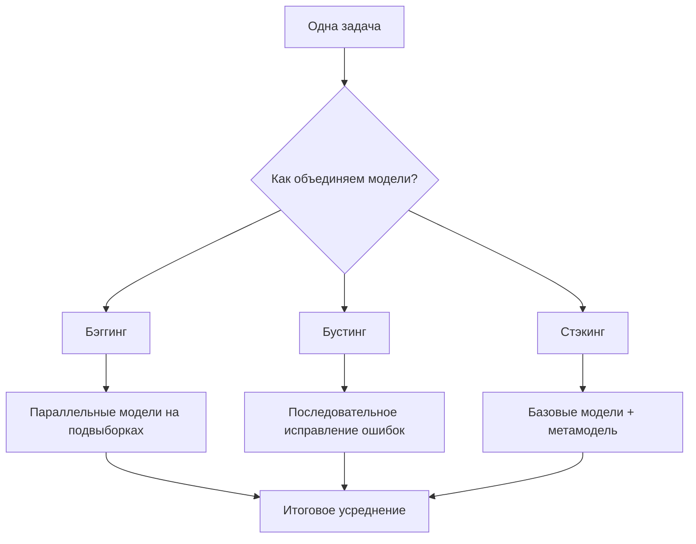

# Лекция 06. Ансамбли моделей

Источник: [[lec6.pdf]]

## Что покрывает эта лекция

- Вопросы экзамена: 28, 29, 30, 31, 32, 81, 82, 83, 84, 85, 86.
- Частично: вопрос 33, потому что ансамбли почти всегда требуют настройки гиперпараметров и кросс-валидации.

## Блок-схема ансамблирования

## Что такое ансамблирование

Ансамбль - это комбинация нескольких моделей, прогнозы которых объединяются для получения более качественного итогового решения.

Главная идея:

- одна модель ошибается одним образом;
- другая - другим;
- если объединить их грамотно, можно снизить ошибку, дисперсию или смещение.

Ансамблирование также называют `метаобучением`.

## Почему ансамбли работают

Эффект возникает, когда базовые модели:

- делают не полностью одинаковые ошибки;
- учатся на разных подвыборках;
- используют разные признаки или архитектуры;
- имеют разную индуктивную предвзятость.

Если все модели одинаковы и ошибаются одинаково, ансамбль почти ничего не даст.

## Три базовых подхода

### Бэггинг

Параллельное обучение множества моделей на случайных подвыборках и усреднение их прогнозов.

### Бустинг

Последовательное обучение моделей, где каждая следующая исправляет ошибки предыдущих.

### Стэкинг

Комбинация нескольких разных моделей через отдельную метамодель, которая учится правильно их объединять.

## Бэггинг

### Принцип

`Bagging` = `bootstrap aggregating`.

Идея:

1. Из исходной выборки строят много бутстрап-подвыборок.
2. На каждой обучают базовую модель.
3. Затем прогнозы усредняют или голосуют.

### Что такое бутстрап

Бутстрап-выборка - случайная выборка с возвращением из исходного train-набора.

### Плюсы бэггинга

- уменьшает дисперсию;
- повышает устойчивость;
- хорошо работает с нестабильными базовыми моделями, например деревьями решений;
- позволяет распараллеливание.

### Минусы бэггинга

- ухудшает интерпретируемость;
- требует больше памяти и вычислений;
- не всегда сильно снижает смещение.

## Усреднение и голосование

Для классификации ансамбли часто используют:

- `hard voting` - выбор класса большинством голосов;
- `soft voting` - усреднение вероятностей классов.

Для регрессии обычно усредняют численные предсказания.

## Решающие деревья как база ансамблей

Дерево решений очень удобно для ансамблирования, потому что:

- оно простое;
- легко переобучается как одиночная модель;
- чувствительно к составу данных;
- а значит, ансамбль из деревьев позволяет хорошо усреднять нестабильность.

Это и объясняет, почему дерево решений стало базовым блоком для `Random Forest`, `XGBoost`, `CatBoost`, `LightGBM` и многих других моделей.

## Random Forest

### Что это такое

`Random Forest` - ансамбль деревьев решений, обученных на случайных подвыборках объектов и признаков.

### Как он работает

1. Для каждого дерева берут бутстрап-подвыборку объектов.
2. В каждом узле рассматривают случайное подмножество признаков.
3. Деревья строятся независимо.
4. Итоговый ответ агрегируется по всем деревьям.

### Почему случайность полезна

Если все деревья будут видеть одни и те же данные и одни и те же признаки, они станут слишком похожими. Случайность увеличивает разнообразие и повышает выгоду от ансамбля.

### Основные гиперпараметры

#### `n_estimators`

Число деревьев.

- больше деревьев обычно повышает устойчивость;
- после некоторого момента прирост качества выходит на плато;
- растут время и память.

#### `max_depth`

Максимальная глубина дерева.

- большая глубина снижает bias;
- но может усиливать переобучение и увеличивать ресурсоёмкость.

#### `max_features`

Сколько признаков доступно при разбиении в узле.

- это один из самых важных параметров;
- влияет на разнообразие деревьев.

#### `min_samples_split`

Минимум объектов для расщепления узла.

#### `min_samples_leaf`

Минимум объектов в листе.

Полезен для сглаживания слишком мелких и нестабильных правил.

#### `criterion`

Критерий качества разбиения:

- `gini`, `entropy` для классификации;
- `mse`, `mae` и другие для регрессии.

### Преимущества Random Forest

- сильный универсальный baseline;
- устойчив к шуму;
- умеет оценивать важность признаков;
- работает на классификации и регрессии;
- относительно мало требует тонкой настройки.

### Недостатки

- хуже интерпретируется, чем одиночное дерево;
- может быть тяжёлым по памяти;
- не всегда лучший выбор на очень больших табличных данных, где бустинги часто сильнее.

## Бустинг

### Общий принцип

В бустинге модели обучаются не независимо, а последовательно.

Каждая новая модель пытается исправить ошибку ансамбля, накопленного ранее.

### Интуиция

Если бэггинг уменьшает в первую очередь дисперсию, то бустинг часто борется со смещением и строит более сложную аппроксимацию.

## AdaBoost

Исторически важный алгоритм:

- увеличивает вес объектов, на которых предыдущие слабые модели ошиблись;
- следующая модель сильнее фокусируется на трудных примерах.

Сегодня AdaBoost важен скорее как историческая ступень и как объяснение идеи бустинга.

## Градиентный бустинг

### Основная идея

Градиентный бустинг рассматривает обучение ансамбля как пошаговую оптимизацию функции потерь.

На каждой итерации:

- текущий ансамбль уже даёт предсказание;
- вычисляется, где и как он ошибается;
- новая базовая модель обучается приближать отрицательный градиент функции потерь.

### Почему это мощно

Такой подход:

- универсален;
- позволяет использовать разные функции потерь;
- очень силён на табличных данных.

## LogitBoost

`LogitBoost` - вариант бустинга, ориентированный на задачи классификации и оптимизацию логистической функции потерь.

Для экзамена достаточно помнить:

- это специальный бустинговый алгоритм для вероятностной классификации;
- исторически важен как развитие идеи бустинга под логистическую модель;
- в современных практических пайплайнах чаще уступает более универсальным реализациям градиентного бустинга.

## XGBoost

### Что это такое

`XGBoost` - одна из самых известных реализаций градиентного бустинга над деревьями.

### Что делает его сильным

- регуляризация;
- учёт структуры дерева в оптимизации;
- эффективная работа с пропусками;
- параллелизация и инженерная оптимизация;
- встроенные механизмы борьбы с переобучением.

### Когда хорош

- табличные данные;
- соревнования и прикладные аналитические задачи;
- ситуации, где нужен очень сильный quality baseline.

## LightGBM

### Идея

`LightGBM` - ускоренная реализация бустинга от Microsoft, ориентированная на высокую производительность.

### Особенности

- histogram-based обучение;
- leaf-wise рост дерева;
- очень высокая скорость на больших датасетах;
- хорошая работа с большим количеством признаков.

### Риски

- при неаккуратной настройке может сильнее переобучаться;
- требует внимания к параметрам глубины и числу листьев.

## CatBoost

### Что это такое

`CatBoost` - бустинг над деревьями, особенно сильный на табличных данных с категориальными признаками.

### Ключевые особенности

- встроенная работа с категориальными признаками;
- `ordered boosting`, уменьшающий утечки и переобучение;
- симметричные деревья;
- удобная экосистема и инструменты анализа важности признаков.

### Архитектура и принцип работы

1. Строится начальное простое предсказание.
2. Затем последовательно добавляются деревья.
3. Каждое новое дерево обучается исправлять ошибки текущего ансамбля.
4. Для категориальных признаков применяются специальные схемы статистического кодирования.
5. Для снижения переобучения используется упорядоченная обработка примеров.

### Преимущества CatBoost

- отлично работает с категориальными данными;
- часто требует меньше ручной подготовки признаков;
- даёт сильное качество на табличных задачах;
- устойчив и удобен для прикладного использования.

### Недостатки

- не всегда самый быстрый на любом железе;
- при очень больших данных может уступать в скорости специализированным настройкам LightGBM;
- всё равно требует подбора гиперпараметров.

## Сравнение основных бустингов

| Алгоритм | Сильные стороны | Слабые стороны | Когда выбирать |
| --- | --- | --- | --- |
| `XGBoost` | мощный, зрелый, гибкий | бывает тяжелее и медленнее | сильный универсальный бустинг |
| `LightGBM` | очень быстрый, хорош на больших данных | может быть чувствителен к настройке | большие датасеты, много признаков |
| `CatBoost` | сильный на категориальных признаках, удобен | иногда проигрывает по скорости | табличные данные с категориальными столбцами |

## Стэкинг

### Принцип

В стэкинге берут несколько разных базовых моделей и обучают поверх их предсказаний `метамодель`.

### Схема

1. Есть несколько базовых алгоритмов.
2. Каждый делает предсказания.
3. Эти предсказания превращаются в новые признаки.
4. Метамодель учится на этих метапризнаках.

### Зачем нужны фолды

Если строить метапризнаки на тех же данных, на которых базовые модели обучались, легко получить утечку. Поэтому корректный стэкинг обычно строят через out-of-fold-предсказания.

### Преимущества

- позволяет объединить сильные стороны разных семейств моделей;
- часто даёт лучший итоговый результат.

### Недостатки

- сложность реализации;
- риск утечки;
- больше времени на обучение и отладку;
- хуже интерпретируемость.

## Сравнение бэггинга, бустинга и стэкинга

| Подход | Ключевая идея | Основной выигрыш | Основные риски |
| --- | --- | --- | --- |
| `Бэггинг` | параллельное усреднение похожих моделей | снижение дисперсии | рост ресурсов |
| `Бустинг` | последовательное исправление ошибок | высокое качество, снижение смещения | переобучение, чувствительность к настройке |
| `Стэкинг` | метамодель над несколькими моделями | объединение разных подходов | сложность и утечки |

## Практический шаблон: ансамбли на экзамене

### Вопрос 81: Random Forest

1. Подготовить данные.
2. При необходимости закодировать категории.
3. Обучить лес с подбором `n_estimators`, `max_depth`, `max_features`.
4. Оценить по подходящим метрикам.
5. Посмотреть важности признаков.

### Вопрос 82: XGBoost

1. Подготовить train/validation/test.
2. Настроить `learning_rate`, `max_depth`, `n_estimators`, `subsample`.
3. Использовать раннюю остановку.
4. Сравнить с baseline.

### Вопрос 83: CatBoost

1. Выделить категориальные и числовые признаки.
2. Передать категории модели напрямую.
3. Настроить `depth`, `learning_rate`, `iterations`.
4. Проверить важности признаков и качество.

### Вопрос 84: LightGBM

1. Подготовить данные.
2. Настроить `num_leaves`, `learning_rate`, `max_depth`, `n_estimators`.
3. Контролировать переобучение.

### Вопрос 85: стэкинг

1. Выбрать разные базовые модели.
2. Построить out-of-fold-предсказания.
3. Обучить метамодель.
4. Проверить, действительно ли ансамбль лучше всех базовых моделей.

### Вопрос 86: бэггинг

1. Выбрать нестабильную базовую модель, часто дерево.
2. Сформировать бутстрап-подвыборки.
3. Обучить ансамбль.
4. Сравнить дисперсию и качество с одиночной моделью.

## Краткие выводы

- Ансамбли повышают качество за счёт объединения моделей.
- Бэггинг уменьшает дисперсию, бустинг последовательно исправляет ошибки, стэкинг учит метамодель комбинировать алгоритмы.
- `Random Forest`, `XGBoost`, `LightGBM` и `CatBoost` - ключевые прикладные ансамбли для табличных данных.
- Практический успех ансамбля почти всегда зависит от валидации, подбора гиперпараметров и контроля утечек.
