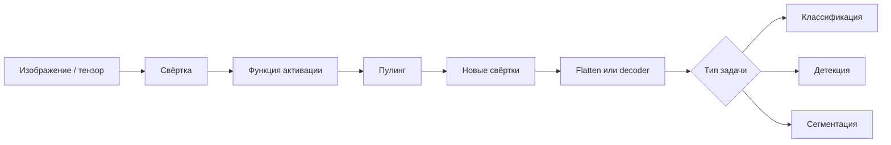

# Лекция 09. Свёрточные нейросети

Источник: [[lec9.pdf]]

## Что покрывает эта лекция

- Вопросы экзамена: 48, 49, 50, 51, 52, 53, 54, 55, 56, 57, 58, 59, 60, 61.
- Частично: вопрос 39, потому что подготовка данных для CNN тесно связана с аугментацией и transfer learning.

## Блок-схема прохождения изображения через CNN

## Зачем понадобились CNN

Обычные полносвязные сети плохо подходят для изображений:

- слишком много параметров;
- не учитываются локальные пространственные связи;
- плохая масштабируемость на больших изображениях.

`CNN` решают эту проблему за счёт локальных фильтров, совместного использования весов и иерархического извлечения признаков.

## Архитектура CNN и отличие от полносвязной сети

### Полносвязная сеть

Каждый нейрон одного слоя соединён со всеми нейронами следующего слоя.

Минусы для изображений:

- огромное число весов;
- потеря локальной структуры;
- высокие требования к памяти.

### Свёрточная сеть

Использует:

- локальные окна;
- общие фильтры;
- карты признаков;
- pooling;
- часто меньшую параметризацию.

Именно поэтому CNN лучше работают с изображениями, чем классические MLP.

## Тензор и математические принципы компьютерного зрения

### Что такое тензор

В контексте CV тензор - это многомерный массив чисел.

Примеры:

- скаляр - число;
- вектор - одномерный массив;
- матрица - двумерный массив;
- изображение RGB - трёхмерный тензор `высота x ширина x каналы`.

### Почему это важно

Нейросеть работает не с объектом `кот`, а с тензором интенсивностей пикселей, из которого постепенно извлекает признаки.

## Операция свёртки

### Основная идея

Свёртка - это операция, при которой небольшой фильтр скользит по изображению и вычисляет отклик на локальный паттерн.

Фильтр может реагировать на:

- края;
- углы;
- текстуры;
- простые формы.

### Зачем нужна свёртка

- резко сокращает число параметров по сравнению с полносвязным подходом;
- использует локальную структуру изображения;
- позволяет строить иерархию признаков.

## Свёрточный слой

Свёрточный слой (`Convolutional Layer`) - слой, который применяет один или несколько фильтров к входному тензору.

### Механизм работы

1. Берётся ядро свёртки.
2. Окно проходит по входу с выбранным шагом.
3. На каждой позиции вычисляется отклик.
4. Из откликов формируется карта признаков.

### Параметры свёрточного слоя

- число фильтров;
- размер ядра;
- шаг `stride`;
- паддинг `padding`;
- функция активации после свёртки.

## Карта признаков, ядро свёртки и окно свёртки

### Ядро свёртки

Небольшая матрица весов, например `3x3` или `5x5`, обучаемая по данным.

### Окно свёртки

Текущая локальная область изображения, на которой фильтр применяется в данный момент.

### Карта признаков

Результат применения одного фильтра ко всему изображению.

Интерпретация:

- если карта ярко активна в области, значит, фильтр нашёл соответствующий паттерн.

## Фильтры и их виды

В классической обработке изображений фильтры могли быть заранее известны:

- выделение вертикальных границ;
- выделение горизонтальных границ;
- размытие;
- усиление контраста.

В CNN фильтры обычно не задаются вручную, а обучаются автоматически.

На ранних слоях они часто находят:

- края;
- линии;
- градиенты.

На более глубоких слоях:

- части объектов;
- текстуры;
- сложные композиции признаков.

## Функции активации в CNN

После свёртки почти всегда добавляют нелинейность.

### ReLU

Самый частый выбор:

- проста;
- ускоряет обучение;
- помогает бороться с затухающим градиентом.

### Другие варианты

- Leaky ReLU;
- GELU;
- sigmoid и tanh в специализированных местах;
- softmax на выходе классификации.

## Пулинг и его роль

`Pooling` - слой уменьшения пространственной размерности карты признаков.

### Зачем нужен

- уменьшает вычисления;
- делает признаки устойчивее к небольшим сдвигам;
- помогает выделить главное.

### Виды пулинга

#### Max Pooling

Берёт максимум из локального окна.

Часто лучше сохраняет наиболее яркий признак.

#### Average Pooling

Берёт среднее значение.

Полезен, когда важно более сглаженное представление.

### Ограничения pooling

Сильный pooling может терять точную пространственную информацию, поэтому в некоторых современных архитектурах его используют осторожно или заменяют другими механизмами.

## Роль полносвязного слоя в CNN

После свёрточных и pooling-слоёв признаки нужно превратить в окончательное решение.

### Для классификации

- карты признаков часто `flatten`-ятся;
- затем проходят через полносвязные слои;
- на выходе получаем вероятности классов.

### Для детекции

- полносвязные слои могут использоваться не всегда в классическом виде;
- часто применяются специализированные head-блоки для классов и рамок.

### Для сегментации

- вместо классического `flatten` часто используют декодерные и транспонированные свёртки, чтобы вернуть пространственное разрешение.

## Как оптимизируют CNN под разные задачи

В зависимости от цели меняется верхушка сети:

- классификация - классовый head;
- детекция - head для класса и координат рамки;
- сегментация - декодер с пиксельным предсказанием;
- генерация - деконволюционные и диффузионные компоненты.

## Принципы обучения CNN

### Общая схема

1. Прямой проход.
2. Вычисление функции потерь.
3. Обратное распространение ошибки.
4. Обновление весов фильтров и полносвязных слоёв.

### Что именно учится

- веса фильтров;
- параметры нормализации;
- веса полносвязных слоёв;
- параметры head-блоков.

## Обратная свёртка и транспонированная свёртка

На слайдах это может называться `обратной свёрткой`, но на практике важно различать понятия.

### В обучении

При backprop ошибка распространяется назад через свёрточные слои, и для этого используются специальные вычисления градиентов.

### В архитектурах сегментации и генерации

Часто используют `транспонированную свёртку` (`transposed convolution`), которая помогает увеличить пространственное разрешение признаков.

Это не буквальная математическая инверсия обычной свёртки, а отдельный обучаемый механизм апсемплинга.

## Преимущества и недостатки CNN

### Преимущества

- меньше параметров, чем у полносвязной сети на изображениях;
- хорошая работа с локальными паттернами;
- устойчивость к умеренным сдвигам и деформациям;
- высокая эффективность для CV-задач;
- возможность переноса предобученных признаков.

### Недостатки

- дорогое обучение;
- потребность в больших датасетах;
- чувствительность к качеству разметки;
- слабая интерпретируемость;
- сложность настройки.

## Борьба с переобучением CNN

### Аугментация данных

Создание новых обучающих примеров из существующих:

- повороты;
- отражения;
- кропы;
- масштабирование;
- шум;
- изменение яркости и контраста;
- mixup и cutmix.

### Регуляризация

- `dropout`;
- `L1/L2`;
- weight decay.

### Ранняя остановка

Остановка обучения, когда качество на валидации перестаёт улучшаться.

### Кросс-валидация

Особенно полезна на маленьких датасетах.

### Нормализация и правильный schedule обучения

- batch normalization;
- learning rate scheduling;
- label smoothing в некоторых задачах.

## Дообучение нейросетей: transfer learning, feature extraction, fine tuning

### Transfer Learning

Использование знаний, полученных на одной задаче, для другой.

### Feature Extraction

Предобученная сеть используется как извлекатель признаков, а сверху обучают новый классификатор.

### Fine Tuning

Последние слои или вся сеть частично размораживаются и дообучаются под новую предметную область.

### Когда это особенно полезно

- маленький датасет;
- дорогая разметка;
- задача похожа на уже изученные визуальные домены.

## История развития CV и свёрточных сетей

### Ключевые этапы

- `LeNet-5` - ранний успешный пример CNN.
- `AlexNet` - прорыв 2012 года, резко усиливший интерес к deep learning в CV.
- `VGG` - показала силу глубоких сетей с маленькими свёртками `3x3`.
- `GoogLeNet/Inception` - более сложное многоветвевое извлечение признаков.
- `ResNet` - остаточные связи и обучение очень глубоких сетей.
- `EfficientNet` - аккуратное масштабирование глубины, ширины и разрешения.
- `YOLO` - детекция объектов в реальном времени.
- далее усилились `U-Net`, `Mask R-CNN`, `ViT`, `Swin` и гибридные архитектуры.

### Перспективные направления

- vision transformers;
- мультимодальные архитектуры;
- foundation models для изображений;
- self-supervised learning;
- более экономичные и мобильные CNN/ViT.

## VGG-16

### Основная идея

`VGG-16` использует много последовательных свёрток `3x3`, постепенно наращивая глубину сети.

### Почему архитектура важна

- показала, что маленькие фильтры можно эффективно комбинировать;
- стала эталонной предобученной сетью для transfer learning.

### Какие задачи решает

- классификация;
- извлечение признаков;
- задачи, где нужен сильный визуальный backbone.

### Преимущества

- понятная структура;
- сильный исторический baseline;
- хороша как feature extractor.

### Недостатки

- очень много параметров;
- тяжёлая по памяти;
- уступает более современным архитектурам по эффективности.

## ResNet и batch normalization

### Проблема очень глубоких сетей

При увеличении глубины сеть становится труднее обучать: усиливаются затухающие градиенты и деградация качества.

### Residual connections

`ResNet` вводит пропускные связи (`skip connections`), позволяющие блоку учить не полное преобразование, а `остаток`.

Это помогает:

- легче проводить градиент;
- обучать очень глубокие сети;
- стабилизировать оптимизацию.

### Batch Normalization

`BatchNorm` нормализует активации внутри минибатча, что:

- ускоряет и стабилизирует обучение;
- позволяет использовать более агрессивные learning rate;
- даёт дополнительный регуляризующий эффект.

### Проблемы архитектуры

- на маленьких batch size BatchNorm может работать хуже;
- ResNet всё равно требует серьёзных вычислительных ресурсов;
- при узкоспециализированных данных нужен fine tuning.

## Семейство YOLO

### Идея

`YOLO` (`You Only Look Once`) решает задачу детекции объектов как единый прямой проход через сеть.

### Принцип работы

Модель сразу предсказывает:

- координаты рамок;
- вероятности объектов;
- классы.

### Почему YOLO стал популярным

- высокая скорость;
- возможность работы в реальном времени;
- хороший баланс качества и производительности.

### Эволюция семейства

Версии YOLO постепенно улучшали:

- точность локализации;
- скорость;
- устойчивость на мелких объектах;
- удобство обучения и инференса.

### Сравнение с VGG

- `VGG` - классическая сеть для классификации и feature extraction;
- `YOLO` - специализированная детекционная архитектура с акцентом на скорость и локализацию.

### Преимущества YOLO

- real-time детекция;
- простая end-to-end схема;
- развитая практическая экосистема.

### Недостатки

- на сложных мелких объектах и плотных сценах некоторые версии уступают более тяжёлым двухступенчатым детекторам;
- требуется аккуратная настройка датасета и аугментаций.

## Как оценивать CNN и CV-модели

Подробная общая рамка находится в [[Лекция 08 - Компьютерное зрение#Метрики качества в компьютерном зрении]], но для этой лекции важно помнить:

- классификация - accuracy, precision, recall, F1;
- детекция - IoU, AP, mAP;
- сегментация - IoU, Dice, pixel accuracy;
- качество архитектуры всегда оценивают вместе с вычислительной стоимостью и скоростью инференса.

## Краткие выводы

- CNN строят иерархию визуальных признаков через свёртки, активации и pooling.
- Ключевые понятия: тензор, ядро, окно свёртки, карта признаков, полносвязный слой.
- Для борьбы с переобучением важны аугментации, регуляризация, early stopping и transfer learning.
- Исторически важные архитектуры: VGG, ResNet, YOLO; современные тренды ведут к гибридам CNN и трансформеров.
