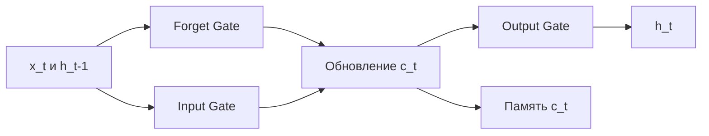

# Лекция 10. Рекуррентные нейросети

Источник: [[lec10.pdf]]

## Что покрывает эта лекция

- Вопросы экзамена: 62, 63, 64, 65, 66, 90, 91.
- Формирует переход от CNN и статических данных к моделям, умеющим работать с последовательностью и контекстом.

## Блок-схема работы LSTM

## Зачем нужны модели для последовательностей

Многие данные имеют естественный порядок:

- текст;
- речь;
- временные ряды;
- музыкальные последовательности;
- телеметрия;
- последовательности действий пользователя.

Если игнорировать порядок элементов, мы теряем контекст. Именно для таких задач и появились рекуррентные нейросети.

## Особенности задач с последовательностями

### Почему контекст важен

Смысл элемента зависит от соседей:

- слово зависит от предыдущих и следующих слов;
- значение временного ряда зависит от прошлых состояний;
- текущая нота зависит от музыкального рисунка.

### Типовые задачи

- анализ тональности текста;
- машинный перевод;
- генерация текста;
- распознавание речи;
- прогноз временных рядов;
- последовательная маркировка токенов.

## Что такое рекуррентная нейросеть

`RNN` - нейросеть, у которой есть внутреннее состояние, передающее информацию между временными шагами.

Главная идея:

- сеть обрабатывает последовательность поэлементно;
- на каждом шаге учитывает текущий вход и память о прошлом.

## Архитектура RNN

### Рекуррентный блок

Базовый строительный блок RNN получает:

- вход `x_t`;
- предыдущее скрытое состояние `h_(t-1)`.

И возвращает:

- новое скрытое состояние `h_t`;
- иногда явный выход `y_t`.

### Что хранится в скрытом состоянии

Скрытое состояние можно понимать как краткое сжатое резюме всего, что модель уже увидела в последовательности.

### Развёртка во времени

Хотя RNN можно рисовать как один блок с петлёй обратной связи, на самом деле при анализе её разворачивают во временную цепочку одинаковых блоков с общими параметрами.

## Виды RNN по схеме входов и выходов

### Один к одному

Обычная статическая сеть.

### Один ко многим

Один вход, много выходов.

Пример:

- генерация последовательности по стартовому состоянию.

### Многие к одному

Много входов, один выход.

Пример:

- анализ тональности предложения;
- классификация временного ряда.

### Многие ко многим

Много входов, много выходов.

Примеры:

- перевод;
- последовательная разметка;
- генерация подписи к данным.

## Известные архитектуры RNN

- классическая `vanilla RNN`;
- сети Хопфилда;
- `LSTM`;
- `GRU`;
- `seq2seq`;
- рекурсивные и гибридные архитектуры.

На практике в классической постановке чаще всего сравнивают `RNN`, `LSTM` и `GRU`.

## Схема работы классической RNN

На каждом шаге происходит:

1. Чтение текущего элемента последовательности.
2. Комбинация его с предыдущим скрытым состоянием.
3. Получение нового состояния.
4. При необходимости вычисление выхода.

Чаще всего:

- на скрытом состоянии используют `tanh`;
- параметры `U`, `W`, `V` повторяются на всех временных шагах.

Это экономит число параметров и даёт модели одинаковое правило обработки на всей длине последовательности.

## Обучение RNN

### Общий принцип

Как и другие нейросети, RNN обучаются по функции потерь с помощью градиентного спуска.

### BPTT

Поскольку параметры общие для всех временных шагов, используют `Backpropagation Through Time` (`BPTT`) - обратное распространение ошибки сквозь время.

Интуитивно:

- ошибка на поздних шагах зависит от ранних состояний;
- градиент нужно протянуть назад через всю последовательность.

## Преимущества и недостатки классической RNN

### Преимущества

- умеет учитывать контекст;
- подходит для последовательностей переменной длины;
- естественно применима к временным рядам и тексту;
- исторически важна как первый рабочий класс последовательностных моделей.

### Недостатки

- затухающие градиенты;
- взрывающиеся градиенты;
- трудно удерживать долгосрочные зависимости;
- последовательная обработка хуже масштабируется, чем у трансформеров.

## Проблемы исчезающего и взрывающегося градиента

### Исчезающий градиент

При прохождении назад градиент многократно умножается на матрицы и производные, и его величина может стремиться к нулю.

Следствие:

- ранние шаги почти перестают влиять на обучение.

### Взрывающийся градиент

Градиент, наоборот, может расти слишком сильно.

Следствие:

- обучение становится нестабильным;
- веса прыгают;
- модель расходится.

### Методы борьбы

- gradient clipping;
- более удачные активации;
- `LSTM` и `GRU`;
- нормализация;
- укороченные последовательности или truncated BPTT.

## Подготовка текста для RNN

Нейросети не умеют работать с сырыми словами напрямую, им нужны числовые представления.

### Этапы подготовки

1. Очистка текста.
2. Токенизация.
3. Построение словаря.
4. Кодирование токенов.
5. Паддинг и усечение последовательностей.
6. Формирование батчей.

### Проблемы на этом этапе

- редкие слова;
- длинные последовательности;
- OOV-токены;
- неодинаковая длина предложений;
- морфологическое разнообразие языка.

## Векторизация текста

### One-Hot Encoding

Каждое слово кодируется большим разреженным вектором, где один элемент равен `1`.

Минусы:

- высокая размерность;
- отсутствие представления смысла и близости слов.

### Bag of Words

Считает частоты слов, но игнорирует порядок.

Для RNN это слабовато, потому что порядок как раз важен.

### TF-IDF

Учитывает важность слова относительно корпуса, но тоже обычно используется вне последовательностных сетей.

### Эмбеддинги

Лучший современный вариант для NLP-пайплайнов.

## Эмбеддинги

Эмбеддинг - плотный вектор низкой размерности, в котором близкие по смыслу слова или токены получают близкие представления.

### Зачем они нужны

- уменьшают размерность;
- кодируют семантическую близость;
- позволяют моделям лучше работать с языком.

### Word2Vec

Классический метод обучения эмбеддингов.

Основные варианты:

- `CBOW` - предсказание слова по контексту;
- `Skip-gram` - предсказание контекста по слову.

### Другие подходы

- `GloVe`;
- fastText;
- контекстные эмбеддинги современных трансформеров.

## LSTM

### Зачем появилась LSTM

Классическая RNN плохо хранит долгосрочные зависимости. `LSTM` была создана, чтобы лучше управлять памятью и уменьшить проблему исчезающего градиента.

### Основная идея

В LSTM есть отдельное состояние ячейки `c_t` и система вентилей, решающих:

- что забыть;
- что запомнить;
- что вывести.

### Вентиль забывания

Определяет, какую часть старой информации оставить.

### Входной вентиль

Решает, какую новую информацию записать в память.

### Обновление состояния

Старая память частично сохраняется и частично дополняется новой.

### Выходной вентиль

Определяет, какая часть состояния станет выходом на текущем шаге.

### Почему LSTM лучше классической RNN

- лучше удерживает долгосрочный контекст;
- стабильнее обучается;
- долгое время была стандартом для NLP и временных рядов.

## Seq2Seq, энкодер и декодер

Для задач вроде перевода длина входа и выхода может различаться.

Тогда используют `sequence-to-sequence` архитектуру:

- `энкодер` читает входную последовательность и строит представление;
- `декодер` по этому представлению генерирует выход.

Эта идея напрямую привела к дальнейшему развитию внимания и трансформеров.

## Механизм внимания

### Зачем он появился

Один фиксированный контекстный вектор для длинной последовательности слишком узок. Важные слова могут потеряться.

### Идея внимания

На этапе генерации модель может по-разному `смотреть` на разные элементы входной последовательности.

То есть:

- не вся история одинаково важна;
- разные токены получают разные веса.

Это улучшает перевод, суммаризацию, диалог и другие задачи.

## Применение RNN, LSTM и attention

- машинный перевод;
- генерация текста;
- классификация последовательностей;
- прогноз временных рядов;
- анализ речи;
- анализ событий в логах.

## Практический шаблон: вопрос 90 про NLP-кейс

### Вариант ответа для перевода текста

1. Подготовить параллельный корпус.
2. Выполнить токенизацию и векторизацию.
3. Построить `seq2seq`-архитектуру на `LSTM` или трансформере.
4. Обучить на train с teacher forcing.
5. Оценить по BLEU или близкой метрике.
6. Проанализировать ошибки: редкие слова, длинные предложения, доменный сдвиг.

## Практический шаблон: вопрос 91 про LSTM

### Если выбран перевод текста

- использовать `LSTM encoder-decoder`;
- отметить роль внимания;
- оценивать качество по текстовым метрикам.

### Если выбран прогноз временного ряда

1. Сформировать последовательности из истории наблюдений.
2. Нормализовать значения.
3. Выбрать окно истории.
4. Обучить `LSTM`.
5. Оценить по `MAE`, `RMSE`, `MAPE`.

### Что важно сказать

- LSTM полезна там, где важна зависимость от прошлого;
- длина окна и качество данных критично влияют на результат;
- трансформеры часто сильнее, но LSTM остаётся понятной и практичной архитектурой.

## Краткие выводы

- RNN созданы для обработки последовательностей и работы с контекстом.
- Классическая RNN важна исторически, но страдает от проблем градиента.
- LSTM решает проблему памяти значительно лучше благодаря вентилям.
- Подготовка текста, эмбеддинги и механизм внимания являются ключевыми элементами современных NLP-пайплайнов.
