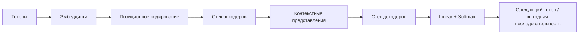

# Лекция 11. Трансформеры

Источник: [[lec11.pdf]]

## Что покрывает эта лекция

- Вопросы экзамена: 67, 68, 69.
- Частично: вопрос 90, так как современные задачи перевода и NLP чаще решаются именно трансформерами.

## Блок-схема трансформера

## Зачем появились трансформеры

Трансформеры возникли как ответ на ограничения RNN и LSTM:

- последовательная обработка мешала эффективной параллелизации;
- длинный контекст обрабатывался хуже;
- обучение на длинных последовательностях было дорогим и нестабильным.

Ключевая идея трансформеров: заменить рекуррентность механизмом внимания.

## Какие задачи решают трансформеры

- машинный перевод;
- суммаризация;
- вопросно-ответные системы;
- классификация текста;
- генерация текста;
- извлечение информации;
- мультимодальные задачи;
- обработка изображений и аудио в адаптированных версиях.

## Что такое трансформер

Трансформер - архитектура глубоких нейронных сетей, основанная на механизме внимания и параллельной обработке элементов последовательности.

Его сила в том, что каждый токен может взаимодействовать с другими токенами напрямую, а не только через цепочку скрытых состояний.

## Архитектура трансформера

Классическая схема состоит из:

- входных эмбеддингов;
- позиционного кодирования;
- стека энкодеров;
- стека декодеров;
- слоя проекции в пространство логитов;
- softmax на выходе.

## Энкодер и декодер

### Энкодер

Преобразует входную последовательность в контекстные представления.

Каждый блок энкодера обычно содержит:

- multi-head self-attention;
- feed-forward network;
- residual connections;
- layer normalization.

### Декодер

Генерирует выходную последовательность.

В классическом варианте содержит:

- masked self-attention;
- cross-attention к выходам энкодера;
- feed-forward network;
- residual connections и нормализацию.

## Механизм внимания

### Общая идея

Для каждого токена модель оценивает, насколько важно смотреть на другие токены последовательности.

### Query, Key, Value

Каждый токен преобразуется в три вектора:

- `Query` - что я ищу;
- `Key` - чем я являюсь;
- `Value` - какую информацию несу.

### Как считается внимание

1. Считается сходство `Query` текущего токена с `Key` других токенов.
2. Полученные оценки масштабируются.
3. Через `softmax` превращаются в веса.
4. Взвешенная сумма `Value` даёт новый контекстный вектор.

Это и есть базовый механизм `scaled dot-product attention`.

## Самовнимание

`Self-attention` означает, что токен смотрит на другие токены той же последовательности.

Преимущества:

- учитывает дальние зависимости напрямую;
- хорошо захватывает контекст;
- легко параллелится.

## Множественное внимание

`Multi-head attention` - несколько независимых механизмов внимания, работающих параллельно в разных подпространствах признаков.

### Зачем нужно несколько голов

- одна голова может следить за синтаксисом;
- другая - за согласованием;
- третья - за дальними смысловыми связями.

На практике это повышает выразительность модели.

## Позиционное кодирование

Поскольку трансформер обрабатывает токены параллельно, ему нужно отдельно сообщить порядок элементов.

Для этого к эмбеддингам добавляют позиционную информацию.

### Зачем это нужно

Без позиционного кодирования последовательности:

- `кот съел рыбу`;
- `рыбу съел кот`

были бы набором одних и тех же слов без учёта порядка.

### Варианты

- синусоидальное позиционное кодирование;
- обучаемые позиционные эмбеддинги;
- относительные позиционные схемы.

## Feed-Forward и остаточные связи

После внимания каждый токен проходит через небольшую полносвязную сеть `FFN`.

### Residual connections

Остаточные связи помогают:

- лучше проводить градиент;
- стабилизировать обучение;
- строить глубокие стеки блоков.

### Layer Normalization

Нормализует представления внутри слоя и делает обучение устойчивее.

## Принцип работы трансформера

### Фаза кодирования

Энкодер строит контекстные представления входных токенов.

### Фаза декодирования

Декодер генерирует выход токен за токеном:

- видит уже сгенерированные токены;
- обращается к информации энкодера;
- возвращает вероятности следующего токена.

В генерации процесс повторяется до специального токена конца последовательности.

## Плюсы и минусы трансформеров

### Преимущества

- отличный учёт длинного контекста;
- параллельная обработка;
- высокая масштабируемость;
- универсальность;
- база для современных LLM.

### Недостатки

- высокая вычислительная сложность внимания;
- большие требования к данным;
- сложность интерпретации;
- ограничение длины контекста;
- возможность галлюцинаций в генеративных постановках.

## Семейства трансформеров

Для общего понимания полезно знать три крупных класса:

### Encoder-only

Пример: `BERT`.

Подходит для:

- классификации;
- поиска;
- извлечения информации;
- маскированного моделирования языка.

### Decoder-only

Пример: `GPT`.

Подходит для:

- автогенерации текста;
- чат-систем;
- продолжения последовательности.

### Encoder-decoder

Примеры: `T5`, `BART`.

Подходят для:

- перевода;
- суммаризации;
- seq2seq-задач.

## Практический взгляд на трансформеры

Если на экзамене спросят про применение:

- перевод и суммаризация - классические `encoder-decoder` модели;
- классификация текста - часто `BERT` и подобные encoder-only архитектуры;
- генерация и диалог - decoder-only семейства.

## Краткие выводы

- Трансформеры заменили рекуррентность вниманием и сделали возможной эффективную работу с длинным контекстом.
- Ключевые элементы: `self-attention`, `multi-head attention`, энкодер, декодер, позиционное кодирование, residual connections.
- Это базовая архитектурная основа современных языковых моделей и многих мультимодальных систем.
