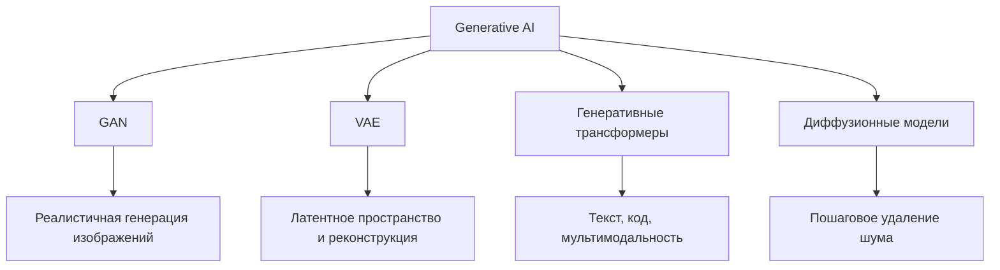

# Лекция 12. Генеративный ИИ

Источник: [[lec12.pdf]]

## Что покрывает эта лекция

- Вопросы экзамена: 70, 71, 72, 73.
- Дополнительно связывает курс с темами `RAG`, `RL` и современными ограничениями генеративных систем.

## Блок-схема семейства генеративных моделей

## Что такое генеративный ИИ

`Generative AI` - класс моделей, способных создавать новые данные, похожие по структуре на обучающие:

- тексты;
- изображения;
- аудио;
- видео;
- код;
- 3D-объекты;
- молекулы и другие специальные представления.

Ключевое отличие от дискриминативных моделей:

- дискриминативная модель отделяет классы или предсказывает таргет;
- генеративная модель пытается моделировать распределение данных и синтезировать новые образцы.

## Задачи и функционал генеративного ИИ

### Основные задачи

- генерация текста;
- генерация изображений;
- генерация речи и музыки;
- редактирование контента;
- inpainting и super-resolution;
- синтез дизайнов и концептов;
- помощь в написании кода;
- генерация данных для аугментации.

### Где применяется

- маркетинг и медиа;
- образование;
- разработка ПО;
- дизайн;
- наука и биоинформатика;
- игровая индустрия;
- персональные ассистенты.

## Почему GenAI стал развиваться так быстро

- сильные трансформеры и foundation models;
- рост вычислительных ресурсов;
- огромные корпусы текстов и изображений;
- transfer learning и fine tuning;
- развитие open-source экосистем.

## Виды генеративных моделей

### GAN

Сильны в синтезе реалистичных изображений.

### VAE

Хороши для латентного представления и генерации из компактного скрытого пространства.

### Трансформерные генеративные модели

Основа современных больших языковых моделей и многих мультимодальных систем.

### Диффузионные модели

Одна из главных современных архитектур генерации изображений и видео.

## Преимущества и недостатки генеративного ИИ

### Преимущества

- автоматизация творческих и рутинных задач;
- быстрый синтез контента;
- помощь в прототипировании;
- расширение возможностей анализа и взаимодействия с данными;
- высокая универсальность foundation-моделей.

### Недостатки

- галлюцинации и фактические ошибки;
- зависимость от качества и актуальности обучающих данных;
- высокая стоимость обучения и инференса;
- риски нарушения авторских прав;
- предвзятость;
- злоупотребления: дипфейки, спам, мошенничество;
- сложность контроля и объяснения результатов.

## Генеративно-состязательные сети

### Архитектура GAN

GAN состоит из двух частей:

- `генератор` создаёт искусственные данные;
- `дискриминатор` пытается отличить реальные данные от сгенерированных.

### Принцип работы

1. Генератор получает случайный шум.
2. По шуму создаёт образец.
3. Дискриминатор оценивает, настоящий образец или подделка.
4. Генератор учится лучше обманывать дискриминатор.
5. Дискриминатор учится лучше распознавать подделки.

Это состязание постепенно улучшает качество генерации.

### Кейсы использования GAN

- генерация фотореалистичных лиц;
- стилизация изображений;
- super-resolution;
- генерация текстур;
- data augmentation.

### Плюсы GAN

- очень реалистичная генерация;
- хорошие визуальные результаты;
- сильны в image-to-image сценариях.

### Минусы GAN

- трудность обучения;
- `mode collapse`;
- нестабильность;
- сложность оценки качества.

## Вариационные автоэнкодеры

### Архитектура VAE

`VAE` состоит из:

- энкодера;
- латентного пространства;
- декодера.

### Принцип работы

1. Энкодер переводит объект в распределение в латентном пространстве.
2. Из этого распределения берётся выборка скрытого вектора.
3. Декодер восстанавливает или генерирует данные по этому вектору.

### В чём особенность

VAE не просто сжимает данные, а учит вероятностное латентное пространство, из которого можно генерировать новые образцы.

### Кейсы использования VAE

- генерация новых объектов;
- сжатие данных;
- аномалии через реконструкционную ошибку;
- интерполяция между образцами.

### Преимущества VAE

- устойчивое и более предсказуемое обучение;
- хорошее латентное пространство;
- удобны для анализа структуры данных.

### Недостатки VAE

- результаты могут быть менее резкими и реалистичными, чем у GAN или современных diffusion-моделей;
- ограниченность качества при очень сложных визуальных данных.

## Диффузионные модели

### Основная идея

Диффузионная модель учится обратному процессу удаления шума.

Интуитивно:

- в прямом процессе к данным постепенно добавляют шум;
- модель обучается шаг за шагом восстанавливать исходную структуру из шумного состояния.

### Почему это работает

Вместо одного прыжка к результату модель делает последовательность небольших улучшений.

### Архитектурные компоненты

Современные diffusion-системы часто включают:

- `U-Net` как основной денойзер;
- текстовый энкодер для conditioning;
- `VAE` для работы в латентном пространстве;
- планировщик шумов и обратных шагов.

### Кейсы использования

- генерация изображений по тексту;
- редактирование изображения;
- inpainting;
- video generation;
- дизайн и концепт-арт.

### Преимущества

- очень высокое качество генерации;
- гибкость управления результатом;
- хорошие мультимодальные возможности.

### Недостатки

- высокая вычислительная цена;
- долгий инференс по сравнению с некоторыми другими подходами;
- сложность контроля и оценки.

## Перспективы развития генеративного ИИ

### Текущие направления

- мультимодальные модели;
- персонализированные и доменные ассистенты;
- управляемая генерация;
- связка с внешними знаниями;
- генеративный дизайн;
- видео, 3D и интерактивные миры.

### Генеративный дизайн

Человек задаёт ограничения, цель и критерии, а система предлагает множество вариантов решения:

- дизайн деталей;
- интерьер;
- архитектура;
- инженерные структуры.

## Ограничения и риски современного GenAI

### Технологические

- устаревание знаний;
- галлюцинации;
- трудность строгой верификации;
- ограниченное контекстное окно;
- чувствительность к промпту.

### Правовые и этические

- авторские права;
- приватность;
- смещённость данных;
- дискриминация;
- безопасность;
- злоупотребление синтетическим контентом.

## RAG как способ усиления генеративных моделей

`Retrieval-Augmented Generation` - подход, в котором генерация ответа дополняется поиском релевантной информации во внешней базе знаний.

### Зачем нужен RAG

- уменьшает галлюцинации;
- помогает опираться на актуальные документы;
- улучшает точность в узкой предметной области;
- делает систему лучше для enterprise-задач.

### Базовый конвейер RAG

1. Пользователь задаёт запрос.
2. Система ищет релевантные документы.
3. Фрагменты документов добавляются в контекст модели.
4. Модель генерирует ответ с опорой на найденные данные.

## Обучение с подкреплением и связь с GenAI

Хотя это отдельное направление ML, для генеративных систем оно важно, потому что:

- используется для донастройки поведения модели;
- помогает учитывать предпочтения пользователя;
- применяется в сценариях `RLHF` и близких подходах.

### Суть RL

Есть:

- агент;
- среда;
- действия;
- награда.

Агент учится максимизировать суммарную награду.

## Как отвечать на вопросы 70-73

### Вопрос 70

Нужно раскрыть:

- определение GenAI;
- виды моделей;
- задачи и функционал;
- плюсы и минусы;
- перспективы.

### Вопрос 71

Нужно описать:

- генератор и дискриминатор;
- состязательное обучение;
- примеры применения;
- плюсы и минусы GAN.

### Вопрос 72

Нужно описать:

- энкодер, латентное пространство, декодер;
- вероятностную природу латентных переменных;
- примеры применения и ограничения VAE.

### Вопрос 73

Нужно описать:

- идею пошагового удаления шума;
- архитектурные компоненты;
- кейсы применения;
- примеры вроде `Stable Diffusion`.

## Краткие выводы

- Генеративный ИИ создаёт новые данные, а не только классифицирует существующие.
- Ключевые классы моделей: `GAN`, `VAE`, генеративные трансформеры и диффузионные модели.
- Современный GenAI очень силён, но ограничен качеством данных, стоимостью, безопасностью и риском галлюцинаций.
- Перспективы развития связаны с мультимодальностью, управляемой генерацией, RAG и более надёжными механизмами контроля качества.
